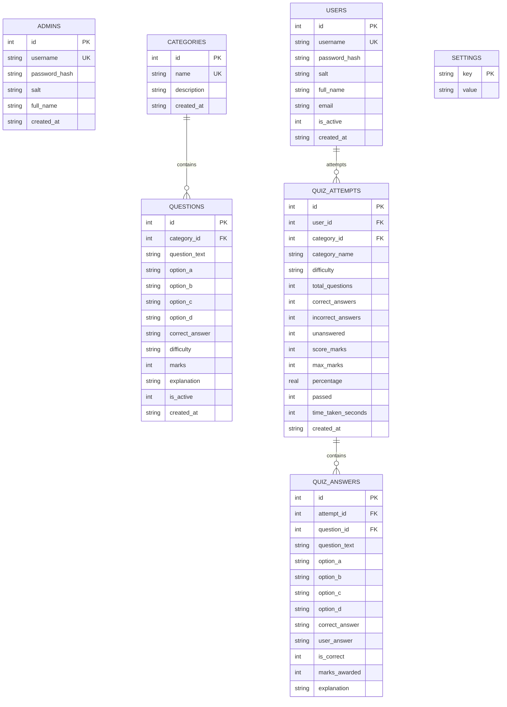

# Python Quiz Management System with Admin Dashboard

A comprehensive, production-grade desktop Quiz Management and Assessment Platform built with **Python**, **Tkinter / ttk**, **SQLite**, and **Matplotlib**. 

The system features two completely separated and role-protected panels:
1. **Admin Dashboard**: Full administrative portal for analytics, question authoring, category management, student account controls, audit reports, CSV exports, and global quiz configuration.
2. **Student / User Portal**: Interactive quiz-taking interface with countdown timer, answer persistence, instant scoring, question reviews with explanations, personal attempt history, and platform leaderboards.

100% offline on Windows with local SQLite data storage.

---

## 🌟 Core Features

### 🛡️ 1. Admin Portal
- **Secure Authentication**: Cryptographically hashed and salted passwords (`hashlib.pbkdf2_hmac` with SHA-256).
- **Interactive Overview Dashboard**:
  - Live metric cards: Total Questions, Total Categories, Registered Users, Total Attempts, Average Score, and System Pass Rate.
  - **Embedded Matplotlib Visualizations**:
    - Bar chart of active questions per category.
    - Donut/Pie chart of overall Pass vs. Fail ratios.
  - Real-time recent activity feed of incoming student attempts.
- **Question Management**:
  - Add, edit, and delete questions with full validation.
  - Search by question text or explanation.
  - Filter by category, difficulty level (*Easy*, *Medium*, *Hard*), and status (*Active*, *Inactive*).
  - Activate or deactivate individual questions without deleting them.
  - **JSON Import & Export**: Import question banks from JSON files or backup current questions.
- **Category Management**:
  - Create and rename categories with custom descriptions.
  - Displays total and active question counts per category.
  - **Safe Deletion Protection**: Blocks accidental deletion of any category that still has associated questions.
- **User Management**:
  - Search student directory by username, name, or email.
  - Monitor quiz attempts count and average scores.
  - Toggle student account access (*Activate / Deactivate*).
  - Secure: Passwords and hashes are never exposed.
- **Quiz Results & Audit Reports**:
  - Filter attempts by category, search by student username, and sort by date or score.
  - **Question-by-Question Review**: Inspect student's chosen answer vs. correct answer and explanation.
  - **CSV Export**: Export all quiz attempts and audit logs to a `.csv` spreadsheet.
- **Global Quiz Settings**:
  - Configurable questions per quiz (e.g. 5, 10, 15, 20).
  - Countdown timer duration (1 to 180 minutes).
  - Passing percentage threshold (e.g. 60%, 75%).
  - Toggle random question ordering.
  - Toggle post-quiz answer key and explanation display.
  - Toggle quiz retake permissions.

### 👤 2. Student Portal
- **User Registration & Login**: Students can sign up and sign in independently.
- **Student Dashboard**:
  - Welcome banner with student name and username.
  - Performance cards: Total Quizzes Taken, Best Score, Average Score, Quizzes Passed.
  - **Category Cards**: Interactive category cards with live question counters.
  - Difficulty selection (*All*, *Easy*, *Medium*, *Hard*).
  - Recent personal quiz attempts table.
  - **Live Leaderboard**: Real-time platform ranking of top scorers based on high score and average score.
- **Live Quiz Screen**:
  - One question displayed at a time with 4 styled option cards.
  - **Live Countdown Timer**: Real-time timer with automatic submission on expiration.
  - **Full Navigation**: *Next* and *Previous* buttons preserve chosen options as students navigate.
  - Visual progress bar and answered question tracker (`Answered: 4/10`).
  - Warning alert if trying to submit with unanswered questions.
  - Anti-duplicate submission protection.
- **Results & Review**:
  - Instant marks calculation, score percentage, and Pass/Fail badge.
  - Time taken tracking.
  - **Detailed Answer Review**: Comprehensive explanation breakdown according to admin permissions.
- **Personal History**:
  - Complete history log accessible only to the logged-in student.

---

## 🔑 Demo Login Credentials

The application initializes with two ready-to-use demo accounts:

| Role | Username | Password | Notes |
| :--- | :--- | :--- | :--- |
| **System Administrator** | `admin` | `admin123` | Full access to Admin Dashboard and Settings |
| **Demo Student** | `student` | `student123` | Standard student account for taking quizzes |

*New students can also register their own accounts directly from the login page!*

---

## 📁 Project Folder Structure

```text
Python Quiz Application/
│
├── main.py                     # Primary desktop entry point & navigation controller
├── database.py                 # SQLite database schema, migrations, CRUD, and queries
├── auth.py                     # Authentication, password hashing, and session verification
├── ui_common.py                # Shared dark theme constants, custom buttons, cards, styles
├── questions.json              # Initial seed question bank (25 curated questions)
├── quiz.db                     # Permanent SQLite database (auto-created on first run)
├── requirements.txt            # Project dependencies (matplotlib)
├── README.md                   # Complete documentation
│
├── admin/                      # Admin Dashboard Subsystem
│   ├── __init__.py
│   ├── dashboard.py            # Overview KPI metrics & Matplotlib analytics charts
│   ├── manage_questions.py     # Question CRUD, filters, JSON import/export
│   ├── manage_categories.py    # Category CRUD with safe-delete protection
│   ├── manage_users.py         # Student directory and account activation controls
│   ├── view_results.py         # Quiz audit table, question breakdown, CSV export
│   └── settings.py             # Global quiz configuration & scoring parameters
│
└── user/                       # Student Portal Subsystem
    ├── __init__.py
    ├── home.py                 # Student home, category selector, and leaderboard
    ├── take_quiz.py            # Countdown timer, question navigation, auto-submit
    ├── results.py              # Score summary, pass/fail badge, answer review
    └── history.py              # Student's personal attempt history
```

---

## 🚀 Setup & Execution Guide (Windows)

### 1. Install Python
1. Download Python 3.8 or newer from [python.org](https://www.python.org/).
2. During installation, **ensure you check the box**: `"Add Python to PATH"`.

### 2. Open Project in VS Code
1. Open Visual Studio Code.
2. Select **File > Open Folder...** and choose `f:\PROJECT\Python Quiz Application`.
3. Open a terminal in VS Code (`Ctrl + ~` or **Terminal > New Terminal**).

### 3. Install Required Dependencies
Install the Matplotlib charting library:

```powershell
pip install -r requirements.txt
```

*(All other modules: `tkinter`, `sqlite3`, `csv`, `json`, `hashlib`, `secrets` are built directly into Python!)*

### 4. Run the Application
Run the main script:

```powershell
python main.py
```

#### Run Without a Terminal Window (Silent GUI Mode):
```powershell
pythonw main.py
```

---

## 🗄️ Database Architecture (`quiz.db`)

The application automatically creates and manages `quiz.db` using relational integrity:



### Database Backup
Because SQLite is self-contained in a single file (`quiz.db`), backing up your entire application data (all questions, users, attempts, and settings) is as simple as copying `quiz.db` to a backup location or external drive.

---

## 📝 How to Add Questions & Categories

### Adding Categories:
1. Log in as an administrator (`admin` / `admin123`).
2. Navigate to **Manage Categories** in the sidebar.
3. Click **➕ Add Category**, enter a name and description, and click **Save**.

### Adding Questions via UI:
1. Navigate to **Manage Questions** in the sidebar.
2. Click **➕ Add Question**.
3. Fill in the Question Text, all four options (A, B, C, D), select the correct answer letter, category, difficulty (*Easy*, *Medium*, *Hard*), marks, and an explanation.
4. Click **💾 Save Question**.

### Importing Questions via JSON:
Click **📥 Import JSON** in Manage Questions to import question banks automatically. Format:

```json
[
  {
    "category": "Python",
    "question": "What is the output of type([]) in Python?",
    "options": ["<class 'list'>", "<class 'tuple'>", "<class 'set'>", "<class 'dict'>"],
    "correct_answer": "A",
    "difficulty": "Easy",
    "marks": 1,
    "explanation": "Square brackets [] instantiate a list object."
  }
]
```

---

## 📦 Converting into a Windows EXE (PyInstaller)

To bundle the application into a standalone Windows executable that can run on any Windows PC without Python installed:

### Step 1: Install PyInstaller
```powershell
pip install pyinstaller
```

### Step 2: Build Executable
Run the following build command in the project directory:

```powershell
pyinstaller --noconsole --onefile --name "PythonQuizSystem" --collect-all matplotlib main.py
```

### Step 3: Run
Navigate into the `dist/` folder and double-click `PythonQuizSystem.exe`. The executable automatically creates and reads `quiz.db` in its directory.

---

## 📄 License
Open-source and free to use for educational, personal, or institutional purposes.
