# A PROJECT REPORT

ON

## **PYTHON QUIZ MANAGEMENT SYSTEM WITH ADMIN DASHBOARD**

---

**Submitted in partial fulfillment of the requirements for the award of the degree of**

### **[Enter Course, e.g., Bachelor of Computer Applications / Bachelor of Technology in Computer Science]**

---

### **Submitted By:**
**Name:** [Enter Student Name]  
**Roll Number:** [Enter Roll Number]  
**Semester / Year:** [Enter Semester, e.g., 6th Semester / 3rd Year]  
**Academic Session:** [Enter Academic Session, e.g., 2025–2026]  

---

### **Under the Guidance of:**
**[Enter Guide Name]**  
[Enter Guide Designation, e.g., Assistant Professor, Department of Computer Science]  

---

### **Department of [Enter Department, e.g., Computer Science and Engineering]**
### **[Enter College / University Name]**
**[Enter College Location / Address]**  

<div style="page-break-after: always;"></div>

---

## **CERTIFICATE**

This is to certify that the project report entitled **"Python Quiz Management System with Admin Dashboard"**, submitted by **[Enter Student Name]** (Roll No: **[Enter Roll Number]**), in partial fulfillment of the requirements for the degree of **[Enter Course]** of **[Enter College Name]**, is an authentic record of independent project work carried out under my supervision and guidance.

To the best of my knowledge, the matter embodied in this report has not been submitted to any other University or Institute for the award of any degree, diploma, or certificate.

<br><br><br>

_______________________________  
**[Enter Guide Name]**  
Project Guide / Supervisor  
Department of [Enter Department]  
[Enter College Name]  

<br><br>

_______________________________  
**[Enter Head of Department Name]**  
Head of the Department  
Department of [Enter Department]  
[Enter College Name]  

<br><br>

_______________________________  
**External Examiner**  
Date of Examination: _______________  

<div style="page-break-after: always;"></div>

---

## **STUDENT DECLARATION**

I, **[Enter Student Name]**, student of **[Enter Course]**, Semester **[Enter Semester]**, Roll Number **[Enter Roll Number]**, at **[Enter College Name]**, hereby declare that the project entitled **"Python Quiz Management System with Admin Dashboard"** is my original work carried out under the supervision of **[Enter Guide Name]**.

I further declare that:
1. The project embodies genuine software development and empirical testing conducted by me.
2. The concepts, algorithms, database designs, and code snippets included in this report are original or properly attributed to their respective official documentation.
3. This work has not been submitted previously to this or any other educational institution for any degree, diploma, or other academic distinction.

<br><br><br>

_______________________________  
**[Enter Student Name]**  
Roll Number: [Enter Roll Number]  
Department of [Enter Department]  
[Enter College Name]  
Date: _______________  
Place: [Enter City / Location]  

<div style="page-break-after: always;"></div>

---

## **ACKNOWLEDGEMENT**

The completion of any project requires the guidance, support, and encouragement of many individuals. I take this opportunity to express my profound gratitude to everyone who made this project possible.

First and foremost, I express my sincere gratitude to my project supervisor, **[Enter Guide Name]**, [Enter Guide Designation], Department of [Enter Department], for valuable advice, constructive criticism, and constant encouragement throughout the design, implementation, and documentation of the **Python Quiz Management System with Admin Dashboard**.

I extend my heartfelt thanks to **[Enter Head of Department Name]**, Head of the Department of [Enter Department], for providing the necessary laboratory infrastructure, computational facilities, and an intellectually stimulating environment.

I also express my gratitude to the honorable Principal / Dean, **[Enter Principal / Dean Name]**, **[Enter College Name]**, for administrative support and encouragement.

I would like to thank all the faculty members of the Department of [Enter Department] for their continuous support and academic guidance during my course of study.

Finally, I owe my deepest gratitude to my family and friends for their moral support, patience, and understanding throughout the development of this project.

<br><br>

**[Enter Student Name]**  
Roll Number: [Enter Roll Number]  
[Enter Course], Semester [Enter Semester]  
[Enter College Name]  

<div style="page-break-after: always;"></div>

---

## **ABSTRACT**

The **Python Quiz Management System with Admin Dashboard** is a desktop software application designed to automate, administer, evaluate, and analyze academic assessments. Built using Python, Tkinter/ttk, SQLite, and Matplotlib, the application addresses the inefficiencies, grading errors, and security vulnerabilities associated with traditional paper-based examinations and unverified online web tests.

The system is architected around two role-protected panels: an **Admin Dashboard** and a **Student / User Portal**. The administrative module empowers educators to author and edit multiple-choice questions (MCQs), organize questions into subject categories, manage registered student credentials, configure global quiz runtime rules (including timer duration, question quota, and passing thresholds), view comprehensive student attempt logs, and export structured audit reports to CSV spreadsheets. Furthermore, the admin interface incorporates embedded Matplotlib analytics, presenting graphical visualizations of category distributions and overall pass/fail ratios.

The student portal features an interface with personalized progress metrics, category-specific quiz launchers, difficulty filters, and a platform-wide competitive leaderboard. The examination engine delivers one question at a time, displays real-time countdown timers with automatic submission upon expiration, tracks progress dynamically, preserves answer selections across forward and backward question navigation, and prevents accidental double-submissions. Post-quiz evaluation is conducted automatically against database-stored keys, presenting students with score percentages, performance badges, and detailed answer reviews with explanations.

Operating completely offline without relying on external web APIs, the system uses an embedded SQLite database (`quiz.db`) that enforces relational integrity through foreign key constraints and transactional snapshots. Sensitive credentials are cryptographically protected using PBKDF2-HMAC-SHA256 password hashing with unique random salts. The resulting application offers an assessment platform suitable for schools, colleges, training centers, and competitive examination preparation.

**Keywords:** *Python, Tkinter, SQLite, Assessment System, Admin Dashboard, Matplotlib, PBKDF2-HMAC-SHA256, Quiz Engine.*

<div style="page-break-after: always;"></div>

---

## **TABLE OF CONTENTS**

- **Certificate**
- **Student Declaration**
- **Acknowledgement**
- **Abstract**
- **Table of Contents**
- **List of Figures**
- **List of Tables**
- **List of Abbreviations**
- **Chapter 1: Introduction**
  - 1.1 Background of the Study
  - 1.2 Purpose of the Project
  - 1.3 Problem Statement
  - 1.4 Objectives of the System
  - 1.5 Scope of the Project
  - 1.6 Need for the Application
  - 1.7 Advantages and Limitations
- **Chapter 2: Existing and Proposed System**
  - 2.1 Traditional / Manual Examination System
  - 2.2 Shortcomings of the Existing Approach
  - 2.3 Proposed Computerized Quiz System
  - 2.4 Advantages of the Proposed System
  - 2.5 Comparative Analysis
- **Chapter 3: Requirement Analysis**
  - 3.1 Functional Requirements
  - 3.2 Non-Functional Requirements
  - 3.3 Hardware Requirements
  - 3.4 Software Requirements
  - 3.5 Python and Dependency Specifications
  - 3.6 User Roles and Access Control Matrix
  - 3.7 Assumptions and Constraints
- **Chapter 4: System Design**
  - 4.1 System Architecture
  - 4.2 Application Workflow
  - 4.3 Administrator Workflow
  - 4.4 Student / User Workflow
  - 4.5 Data Flow Analysis (DFD Level 0 and Level 1)
  - 4.6 Use Case Modeling
  - 4.7 Entity-Relationship (ER) Modeling
  - 4.8 Design Decisions and Patterns
- **Chapter 5: Technology Used**
  - 5.1 Python Programming Language
  - 5.2 Tkinter and Tile Extensions (ttk)
  - 5.3 SQLite Relational Database Engine
  - 5.4 Matplotlib Data Visualization Framework
  - 5.5 JSON (JavaScript Object Notation)
  - 5.6 CSV (Comma-Separated Values)
  - 5.7 Python Standard Cryptography and Utilities
- **Chapter 6: Module Description**
  - 6.1 Authentication Subsystem (`auth.py`)
  - 6.2 Application Entry and Window Controller (`main.py`)
  - 6.3 Shared UI Theme and Styling (`ui_common.py`)
  - 6.4 Admin Overview Dashboard (`admin/dashboard.py`)
  - 6.5 Question Management Module (`admin/manage_questions.py`)
  - 6.6 Category Management Module (`admin/manage_categories.py`)
  - 6.7 User Directory and Account Management (`admin/manage_users.py`)
  - 6.8 Quiz Results and Audit Module (`admin/view_results.py`)
  - 6.9 Global Quiz Settings Module (`admin/settings.py`)
  - 6.10 Student Home and Assessment Launcher (`user/home.py`)
  - 6.11 Live Quiz Engine and Navigation (`user/take_quiz.py`)
  - 6.12 Performance Evaluation and Review (`user/results.py`)
  - 6.13 Student Personal History (`user/history.py`)
  - 6.14 Database Abstraction Layer (`database.py`)
- **Chapter 7: Database Design**
  - 7.1 Database Architecture and Storage
  - 7.2 Relational Schema and Table Specifications
  - 7.3 Data Validation and Integrity Constraints
  - 7.4 Historical Integrity through Result Snapshotting
  - 7.5 Database Initialization and Automatic Seeding
  - 7.6 Backup, Export, and Restoration Procedures
- **Chapter 8: Implementation Details**
  - 8.1 Source Code Structure Overview
  - 8.2 Database Connection and Foreign Key Enforcement
  - 8.3 Table Schema Generation and Seeding
  - 8.4 Cryptographic Password Hashing and Salt Verification
  - 8.5 Question Authoring and Parameterized Queries
  - 8.6 Category Safe Deletion Mechanism
  - 8.7 Countdown Timer and Auto-Submission Engine
  - 8.8 Server-Side Score Calculation and Attempt Snapshotting
  - 8.9 CSV Audit Export Implementation
  - 8.10 Matplotlib Canvas Embedding in Tkinter
- **Chapter 9: User Manual**
  - 9.1 System Requirements & Prerequisites
  - 9.2 Installing Python and Setting Up Environment
  - 9.3 Opening the Project in VS Code
  - 9.4 Running the Application (Standard & Silent GUI Mode)
  - 9.5 Administrator User Guide
  - 9.6 Student User Guide
  - 9.7 Database Backup Instructions
- **Chapter 10: System Testing**
  - 10.1 Testing Methodology
  - 10.2 Test Environment
  - 10.3 Test Cases and Execution Results
  - 10.4 Boundary Conditions and Error Handling Verification
  - 10.5 Security, Authentication, and Persistence Testing
- **Chapter 11: Results and Discussion**
  - 11.1 Features Demonstrated
  - 11.2 System Benefits and Academic Value
  - 11.3 Performance and Resource Consumption
  - 11.4 Application Interface Screenshots
- **Chapter 12: Security and Data Management**
  - 12.1 Cryptographic Password Protection
  - 12.2 Role-Based Access Control (RBAC)
  - 12.3 SQL Injection Prevention via Parameterized Queries
  - 12.4 Input Sanitization and Boundary Validation
  - 12.5 Student Data Privacy and Ethical Design
  - 12.6 Known Security Boundaries
- **Chapter 13: Limitations and Future Scope**
  - 13.1 Current System Limitations
  - 13.2 Future Enhancements
- **Chapter 14: Conclusion**
  - 14.1 Fulfillment of Project Objectives
  - 14.2 Learning Outcomes and Technical Competencies
  - 14.3 Final Assessment
- **References / Bibliography**
- **Appendices**
  - Appendix A: Complete Project Folder Structure
  - Appendix B: Useful Terminal Commands
  - Appendix C: Database Schema Quick Reference
  - Appendix D: Sample Question JSON Format
  - Appendix E: Glossary of Technical Terms

<div style="page-break-after: always;"></div>

---

## **LIST OF FIGURES**

| Figure No. | Figure Caption | Chapter / Section |
| :---: | :--- | :---: |
| **Figure 4.1** | Four-Tier System Architecture Diagram | Chapter 4.1 |
| **Figure 4.2** | High-Level Application Workflow Diagram | Chapter 4.2 |
| **Figure 4.3** | Administrator Portal Navigation and Workflow | Chapter 4.3 |
| **Figure 4.4** | Student Quiz Lifecycle and Navigation Flowchart | Chapter 4.4 |
| **Figure 4.5** | Data Flow Diagram (DFD Level 0 - Context Level) | Chapter 4.5 |
| **Figure 4.6** | Data Flow Diagram (DFD Level 1 - Detailed Processes) | Chapter 4.5 |
| **Figure 4.7** | Entity-Relationship (ER) Diagram of `quiz.db` | Chapter 4.7 |
| **Figure 11.1** | Unified Login and Portal Selection Screen | Chapter 11.4 |
| **Figure 11.2** | Admin Dashboard Overview with Live Metrics and Matplotlib Charts | Chapter 11.4 |
| **Figure 11.3** | Question Management Window with Filtering Toolbar | Chapter 11.4 |
| **Figure 11.4** | Category Management Window with Question Counters | Chapter 11.4 |
| **Figure 11.5** | User Directory and Account Management Window | Chapter 11.4 |
| **Figure 11.6** | Quiz Results and Audit Reports Window with CSV Export | Chapter 11.4 |
| **Figure 11.7** | Global Quiz Settings Configuration Form | Chapter 11.4 |
| **Figure 11.8** | Student Home Dashboard with Category Cards and Leaderboard | Chapter 11.4 |
| **Figure 11.9** | Student Live Quiz Interface with Timer and Option Cards | Chapter 11.4 |
| **Figure 11.10** | Post-Quiz Performance Summary Screen with Pass/Fail Badge | Chapter 11.4 |
| **Figure 11.11** | Detailed Answer Key Review Screen with Explanations | Chapter 11.4 |
| **Figure 11.12** | Student Personal Examination History Screen | Chapter 11.4 |

---

## **LIST OF TABLES**

| Table No. | Table Caption | Chapter / Section |
| :---: | :--- | :---: |
| **Table 2.1** | Comparison between Traditional and Proposed Quiz System | Chapter 2.5 |
| **Table 3.1** | Minimum and Recommended Hardware Specifications | Chapter 3.3 |
| **Table 3.2** | Software Platform Specifications | Chapter 3.4 |
| **Table 3.3** | User Roles and Access Control Matrix | Chapter 3.6 |
| **Table 6.1** | Summary of Application Modules and Source Files | Chapter 6 |
| **Table 7.1** | Schema Description for `admins` Table | Chapter 7.2 |
| **Table 7.2** | Schema Description for `users` Table | Chapter 7.2 |
| **Table 7.3** | Schema Description for `categories` Table | Chapter 7.2 |
| **Table 7.4** | Schema Description for `questions` Table | Chapter 7.2 |
| **Table 7.5** | Schema Description for `quiz_attempts` Table | Chapter 7.2 |
| **Table 7.6** | Schema Description for `quiz_answers` Table | Chapter 7.2 |
| **Table 7.7** | Schema Description for `settings` Table | Chapter 7.2 |
| **Table 10.1** | Test Execution Matrix and Verified Test Cases | Chapter 10.3 |
| **Table 11.1** | System Resource Usage and Benchmarks | Chapter 11.3 |

---

## **LIST OF ABBREVIATIONS**

| Abbreviation | Complete Expansion |
| :--- | :--- |
| **API** | Application Programming Interface |
| **CSV** | Comma-Separated Values |
| **DB** | Database |
| **DFD** | Data Flow Diagram |
| **DPI** | Dots Per Inch |
| **ER / ERD** | Entity-Relationship / Entity-Relationship Diagram |
| **EXE** | Executable File |
| **FK** | Foreign Key |
| **GUI** | Graphical User Interface |
| **HMAC** | Hash-Based Message Authentication Code |
| **JSON** | JavaScript Object Notation |
| **KPI** | Key Performance Indicator |
| **MCQ** | Multiple Choice Question |
| **OS** | Operating System |
| **PBKDF2** | Password-Based Key Derivation Function 2 |
| **PK** | Primary Key |
| **RAM** | Random Access Memory |
| **RBAC** | Role-Based Access Control |
| **RDBMS** | Relational Database Management System |
| **SHA-256** | Secure Hash Algorithm (256-bit Digest) |
| **SQL** | Structured Query Language |
| **UI** | User Interface |
| **UK** | Unique Key |
| **UX** | User Experience |
| **VS Code** | Visual Studio Code |

<div style="page-break-after: always;"></div>

---

# **CHAPTER 1: INTRODUCTION**

### 1.1 Background of the Study
Assessment is an integral component of the educational ecosystem. Whether in primary education, university degree programs, or corporate certification regimes, periodic quizzes allow educators to evaluate comprehension, measure learning outcomes, and pinpoint curricular deficiencies. Historically, quizzes were conducted on paper sheets, requiring invigilators to physically distribute questionnaires, supervise students, collect answer sheets, and spend considerable hours grading scripts manually.

With the advent of personal computing, computerized testing gained prominence. However, many contemporary solutions require continuous high-speed internet connectivity, proprietary software licenses, or complex server infrastructure. In regional institutions, remote laboratories, and computer centers with intermittent network access, web-based examination platforms often fail due to connection drops or server timeouts. A standalone, desktop-based assessment software solution provides reliable, immediate testing capabilities without network dependency.

### 1.2 Purpose of the Project
The primary purpose of the **Python Quiz Management System with Admin Dashboard** is to deliver a complete, resilient, and beginner-friendly desktop evaluation platform. By consolidating question authoring, categorized repository management, automated real-time test administration, instant grading, and historical record-keeping into a single standalone application, the project eliminates manual marking efforts, mitigates grading errors, and provides objective educational feedback.

### 1.3 Problem Statement
Traditional paper-based quizzes and lightweight script-based assessment tools suffer from significant operational challenges:
1. **Administrative Overhead:** Printing, collating, distributing, and collecting paper tests consumes substantial financial and logistical resources.
2. **Grading Inefficiency:** Manual evaluation of multiple-choice tests is tedious, time-consuming, and prone to human error.
3. **Delayed Feedback:** Students often wait days or weeks to receive test scores, decoupling performance feedback from the learning cycle.
4. **Lack of Analytical Visibility:** Instructors lack automated tools to track pass/fail metrics, monitor category performance, or visualize question difficulty across cohorts.
5. **Security Vulnerabilities:** Paper test papers risk premature leakages, while basic digital tools often store answers in plaintext files accessible to candidates.
6. **Network Vulnerability in Web Tools:** Many existing electronic quiz tools rely entirely on cloud servers and internet connections, leaving them unusable during local network outages.

### 1.4 Objectives of the System
The project was designed and implemented to satisfy the following primary objectives:
- **Role-Protected Architecture:** Establish two distinct interfaces—an **Admin Dashboard** for managerial controls and a **Student Portal** for test taking.
- **Dynamic Question Management:** Enable administrators to create, edit, delete, activate, deactivate, search, and filter MCQs across distinct categories and difficulty levels.
- **Safe Category Lifecycle:** Organize questions under subject categories and implement deletion safeguards to prevent accidental data loss.
- **Robust Examination Engine:** Provide candidates with a timed, interactive quiz screen displaying one question at a time, four selectable options, visual progress tracking, and forward/backward navigation with answer preservation.
- **Automated Score Computation:** Automatically calculate scores, mark percentages, correct counts, incorrect counts, and pass/fail statuses against database-verified answer keys.
- **Audit Trails & Reporting:** Store attempt histories, question-level snapshots, and timestamps in an embedded SQLite database (`quiz.db`), with capabilities to export results to CSV and question banks to JSON.
- **Security & Privacy:** Enforce cryptographically salted PBKDF2-HMAC-SHA256 password hashing and utilize SQL parameterization to prevent injection vulnerabilities.
- **Offline Usability:** Deliver an application that operates without requiring internet access, cloud servers, or third-party web APIs.

### 1.5 Scope of the Project
The scope of this project encompasses:
- Local offline deployment on Windows workstations running Python 3.8+.
- Management of multiple-choice questions with exactly four choices, single correct answers, marks allocations, and educational explanations.
- Relational data persistence using an embedded SQLite database file (`quiz.db`).
- Interactive dashboard analytics powered by embedded Matplotlib charts.
- Export of assessment records to industry-standard CSV format and question exchange via JSON.
- Packaging compatibility into a standalone Windows `.exe` executable via PyInstaller.

### 1.6 Need for the Application
Academic institutions, coaching academies, and self-study learners require testing software that is lightweight, transparent, and completely independent of third-party cloud outages. The **Python Quiz Management System** fulfills this need by providing an open-source, easily deployable desktop solution that runs smoothly on standard laboratory personal computers without licensing fees.

### 1.7 Advantages and Limitations
#### Advantages:
- **Zero Cloud Dependence:** Works 100% offline; eliminates test cancellations caused by network latency or internet outages.
- **Instant Objective Feedback:** Calculates scores instantly upon quiz submission and displays educational explanations.
- **Relational Integrity:** Implements foreign keys and question snapshots so that editing a question later does not corrupt historical student scores.
- **Modern Visual Ergonomics:** Features an eye-friendly Slate & Indigo dark theme with High-DPI font scaling on Windows.
- **Low Resource Consumption:** Minimal CPU and RAM utilization compared to browser-based web applications.

#### Limitations:
- Single-workstation scope in its current desktop form (each desktop maintains its local `quiz.db`).
- Limited to Multiple Choice Questions (single answer selection); subjective essay questions are not supported.
- Requires local Python runtime or pre-compiled Windows executable packaging.

<div style="page-break-after: always;"></div>

---

# **CHAPTER 2: EXISTING AND PROPOSED SYSTEM**

### 2.1 Traditional / Manual Quiz Management
In a conventional academic environment, quiz management is predominantly manual:
1. An instructor manually authors questions and types them into a word processor.
2. Question sheets are physically printed and photocopied according to student enrollment.
3. Invigilators physically administer the test within a designated classroom, continuously tracking wall clocks.
4. Students write or circle answers on paper question sheets.
5. Answer sheets are manually collected, tallied, and corrected against an answer sheet.
6. Scores are transcribed by hand into grade ledgers or spreadsheets.

### 2.2 Shortcomings of the Existing Approach
The traditional system presents several disadvantages:
- **Material Waste:** Heavy consumption of paper, printing cartridges, and stationery.
- **Human Error:** Transposition mistakes during manual correction and score tallying.
- **Security Risks:** Physical question papers can be stolen, misplaced, or damaged.
- **Time Inefficiency:** Educators dedicate substantial working hours to grading rather than teaching.
- **Lack of Answer Preservation:** If a student erases or crosses out answers on paper, optical markers or teachers may misread the intent.
- **Absence of Real-time Analytics:** Generating visual performance distributions or category breakdowns requires manual statistical computation.

### 2.3 Proposed Computerized Quiz System
The proposed **Python Quiz Management System** replaces physical paper examinations with an automated desktop environment. Administrators manage an evolving digital question bank, categorized by subject and difficulty. When a student initiates a quiz, the system dynamically queries the database, randomizes question sequences if configured, delivers questions via a graphical interface, counts down time accurately, computes marks automatically upon submission, records results in an SQLite database, and presents detailed reviews.

### 2.4 Advantages of the Proposed System
- **Immediate Result Generation:** Scores and percentages are computed within milliseconds of submission.
- **Automated Timer Supervision:** Eliminates invigilator subjectivity; the system auto-submits tests when time expires.
- **Secure Password Hashing:** Replaces plaintext student lists with cryptographically hashed credentials.
- **Comprehensive Review Mode:** Students immediately inspect which questions they missed and read explanatory notes.
- **Standardized Export:** Examination results can be exported directly into CSV format for administrative archiving.

### 2.5 Comparative Analysis

**Table 2.1: Comparison between Traditional and Proposed Quiz System**

| Evaluation Parameter | Traditional Manual System | Proposed Python Quiz System |
| :--- | :--- | :--- |
| **Testing Medium** | Paper sheets and physical pens | Graphical Desktop GUI (Tkinter) |
| **Question Storage** | Paper files or unorganized documents | Normalized SQLite Relational Database (`quiz.db`) |
| **Evaluation Method** | Manual grading by teachers | Automated, instant computer evaluation |
| **Result Turnaround** | Hours, days, or weeks | Instantaneous (under 100 milliseconds) |
| **Timer Enforcement** | Manual supervision via wall clock | Automated countdown timer with auto-submit |
| **Human Bias / Error** | High risk during grading and tallying | Zero bias; deterministic verification against keys |
| **Historical Records** | Physical paper registers or folders | SQLite attempt tables and CSV export logs |
| **Question Reusability** | Requires reprinting and re-collating | Stored centrally; reusable across categories |
| **Analytics & Charts** | Manual plotting and statistical formulas | Live embedded Matplotlib charts and KPI cards |
| **Data Security** | Physical locks; easily vulnerable | Salted PBKDF2-HMAC-SHA256 password hashing |

<div style="page-break-after: always;"></div>

---

# **CHAPTER 3: REQUIREMENT ANALYSIS**

### 3.1 Functional Requirements
Functional requirements define the core operations and services the software must execute.

#### 3.1.1 Administrative Module:
- **FR-A01 (Admin Authentication):** The system must authenticate administrator credentials against the `admins` table using PBKDF2-HMAC-SHA256 password hashing.
- **FR-A02 (Analytics Dashboard):** The system must display live counts of total questions, active questions, categories, registered users, total attempts, system average score, and pass rates.
- **FR-A03 (Visual Analytics):** The system must generate Matplotlib bar charts for category question distributions and pie charts for pass/fail ratios.
- **FR-A04 (Question Authoring):** The admin must be able to add new questions containing question text, four non-empty options, a designated correct answer (A, B, C, or D), category assignment, difficulty, marks, and explanations.
- **FR-A05 (Question Modification & Deletion):** The admin must be able to edit existing questions and delete questions with a confirmation prompt.
- **FR-A06 (Question Activation Toggle):** The admin must be able to toggle the `is_active` state of questions without deleting them.
- **FR-A07 (Category Management):** The admin must be able to add, rename, and view categories, with deletion blocked if active questions are attached.
- **FR-A08 (User Account Controls):** The admin must be able to view registered students and toggle their active/inactive status.
- **FR-A09 (Audit Reports & CSV Export):** The admin must be able to filter all student quiz attempts and export the records into a CSV file.
- **FR-A10 (JSON Question Import/Export):** The admin must be able to backup questions to JSON and import question sets with schema validation.
- **FR-A11 (Global Settings Configuration):** The admin must be able to update questions per quiz, timer minutes, passing percentages, and retake/review permissions.

#### 3.1.2 Student / User Module:
- **FR-U01 (User Registration):** Prospective candidates must be able to register new accounts with full names, usernames, emails, and passwords.
- **FR-U02 (User Login):** Registered users must be authenticated, and deactivated accounts must be rejected.
- **FR-U03 (Student Dashboard):** The system must display personalized statistics (quizzes taken, best score, average score, passes), recent attempts, and platform leaderboard.
- **FR-U04 (Quiz Launcher):** Students must be able to select specific subject categories or an "All Categories" comprehensive exam, along with difficulty levels.
- **FR-U05 (Interactive Test Runner):** The system must present one question at a time with four selectable option cards, visual progress indicators, and question counters.
- **FR-U06 (Navigation & Answer Persistence):** Students must be able to navigate using Previous and Next buttons while preserving previously chosen options.
- **FR-U07 (Countdown Timer & Auto-Submit):** The system must display a real-time countdown timer that triggers automatic submission when time runs out.
- **FR-U08 (Incomplete Warning):** The system must warn candidates if they attempt to submit with unanswered questions.
- **FR-U09 (Instant Result Presentation):** The system must calculate percentage, marks, and pass/fail status immediately upon submission.
- **FR-U10 (Detailed Answer Review):** If enabled in global settings, the system must display each question with the student's answer, correct answer, and explanation.
- **FR-U11 (Personal History Log):** Students must be able to view their historical attempt records.

### 3.2 Non-Functional Requirements
- **NFR-01 (Performance & Responsiveness):** GUI screen transitions and navigation actions must execute in under 100 milliseconds. Scoring computation must conclude in under 50 milliseconds.
- **NFR-02 (Data Integrity):** The database must enforce foreign key integrity (`PRAGMA foreign_keys = ON;`) to prevent orphaned records.
- **NFR-03 (Security):** Plaintext passwords must never be stored in the database or displayed in administrative tables.
- **NFR-04 (Usability & Ergonomics):** The interface must utilize consistent typography (Segoe UI / Helvetica), high-contrast Slate & Indigo dark themes, and visual feedback states (hover, selection, disabled).
- **NFR-05 (Portability):** The software must operate on any 64-bit Windows computer running Python 3.8+ without requiring external web services.

### 3.3 Hardware Requirements

**Table 3.1: Minimum and Recommended Hardware Specifications**

| Component | Minimum Specification | Recommended Specification |
| :--- | :--- | :--- |
| **Processor (CPU)** | Intel Core i3 / AMD Athlon (2.0 GHz) | Intel Core i5 / AMD Ryzen 5 (2.5 GHz or higher) |
| **Memory (RAM)** | 2 GB RAM | 4 GB RAM or higher |
| **Storage (Disk)** | 100 MB available storage space | 500 MB available SSD storage space |
| **Display Resolution** | 1024 x 768 pixels | 1920 x 1080 (Full HD) with High-DPI support |
| **Input Devices** | Standard Keyboard and Mouse / Touchpad | Standard Keyboard and Mouse |

### 3.4 Software Requirements

**Table 3.2: Software Platform Specifications**

| Component | Requirement Specification |
| :--- | :--- |
| **Operating System** | Microsoft Windows 10 / Windows 11 (64-bit) |
| **Python Runtime** | Python 3.8 to Python 3.14 (Official 64-bit distribution) |
| **Integrated Development Environment**| Visual Studio Code / PyCharm / IDLE |
| **Database Engine** | SQLite 3.x (Embedded with Python standard library) |

### 3.5 Python and Dependency Specifications
- **`tkinter` & `ttk`:** Included with standard Windows Python installations.
- **`sqlite3`:** Embedded relational engine included with Python standard library.
- **`matplotlib` (>= 3.7.0):** Required for embedded dashboard analytical charts.
- **`hashlib` & `secrets`:** Built-in cryptographic algorithms for password hashing.
- **`json` & `csv`:** Built-in serialization modules for data import and export.
- **`pyinstaller` (>= 6.0.0, Optional):** Used for compiling the application into a standalone `.exe`.

### 3.6 User Roles and Access Control Matrix

**Table 3.3: User Roles and Access Control Matrix**

| Feature / Action | Guest / Unauthenticated | Student / User | Administrator |
| :--- | :---: | :---: | :---: |
| View Login Screen | Yes | Yes | Yes |
| Register Student Account | Yes | No (Already registered) | No (Admin provisioned) |
| Access Admin Dashboard | No | No | Yes |
| Author / Edit / Delete Questions | No | No | Yes |
| Import / Export JSON Questions | No | No | Yes |
| Manage Categories | No | No | Yes |
| Toggle User Account Access | No | No | Yes |
| View System-Wide Results & CSV Export | No | No | Yes |
| Edit Global Settings | No | No | Yes |
| Launch Category Quiz | No | Yes | No |
| View Personal Performance History | No | Yes | No |
| View Platform Leaderboard | No | Yes | Yes (via Admin metrics) |

### 3.7 Assumptions and Constraints
- The user operates on a personal computer running a compatible Microsoft Windows OS.
- Only one candidate takes an examination on a specific local desktop session at any given time.
- All multiple-choice questions adhere strictly to four options labeled A, B, C, and D.
- SQLite database writes are handled locally on disk without networked multi-master replication.

<div style="page-break-after: always;"></div>

---

# **CHAPTER 4: SYSTEM DESIGN**

### 4.1 System Architecture
The application adheres to a modular **Four-Tier Desktop Architecture**:
1. **Presentation Layer (UI):** Built using Tkinter widgets, ttk styles, custom frames (`OptionCard`, `StatCard`, `ScrollableFrame`), and embedded Matplotlib figures (`FigureCanvasTkAgg`).
2. **Controller & Workflow Layer:** Coordinates view swaps, state management, question navigation sequences, and countdown timer callbacks.
3. **Business Logic & Security Layer:** Handles score computation, passing validation, input sanitization, category deletion checks, and PBKDF2-HMAC-SHA256 password hashing.
4. **Data Access & Storage Layer:** Manages parameterized SQLite operations, transaction rollbacks, table seeding, and file input/output (CSV and JSON).

```
+-----------------------------------------------------------------------+
|                       PRESENTATION TIER (UI)                          |
|  Tkinter Windows | ttk Treeview | Custom OptionCards | Matplotlib GUI |
+-----------------------------------------------------------------------+
                                   |
+-----------------------------------------------------------------------+
|                    CONTROLLER & NAVIGATION TIER                       |
|   QuizSystemApp | Session Router | Countdown Timer | View Swapping    |
+-----------------------------------------------------------------------+
                                   |
+-----------------------------------------------------------------------+
|                   BUSINESS LOGIC & SECURITY TIER                      |
|  Score Evaluator | Category Validator | PBKDF2 Auth | Snapshotter     |
+-----------------------------------------------------------------------+
                                   |
+-----------------------------------------------------------------------+
|                     DATA ACCESS & STORAGE TIER                        |
|  database.py (SQLite) | CSV Exporter | JSON Parser | quiz.db File     |
+-----------------------------------------------------------------------+
```
*Figure 4.1: Four-Tier System Architecture Diagram*

### 4.2 Application Workflow
Upon execution, `main.py` initializes the database, configures High-DPI awareness, and routes the user to the unified Login Screen. Users select either the **Student Login** or **Admin Portal** tab. Validated sessions transition to their respective portals.

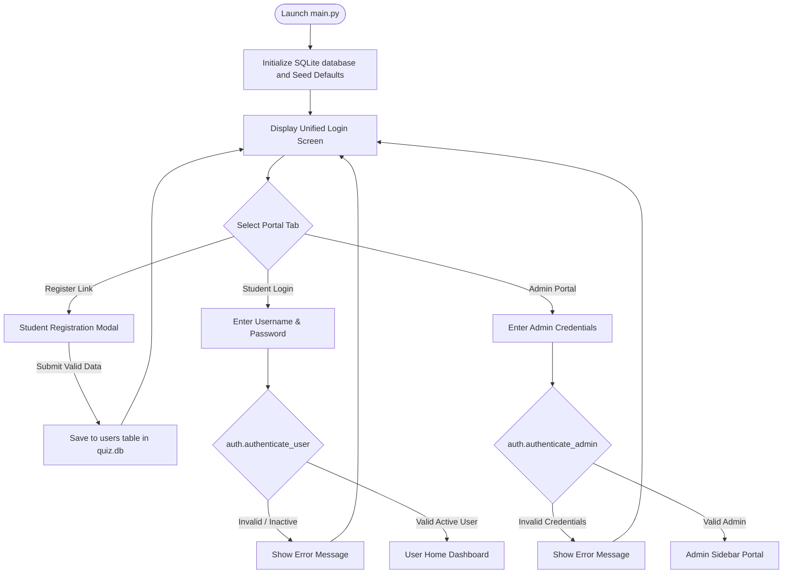
*Figure 4.2: High-Level Application Workflow Diagram*

### 4.3 Administrator Workflow
The administrator portal utilizes a persistent left sidebar enabling navigation across six specialized management modules without opening separate detached windows.

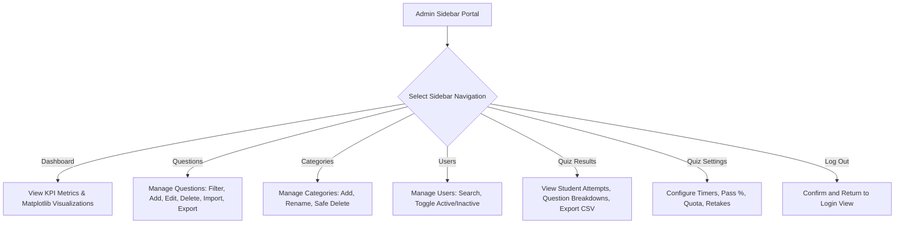
*Figure 4.3: Administrator Portal Navigation and Workflow*

### 4.4 Student / User Workflow
The student lifecycle encompasses category selection, live test navigation, automated grading, and comprehensive post-quiz answer reviews.

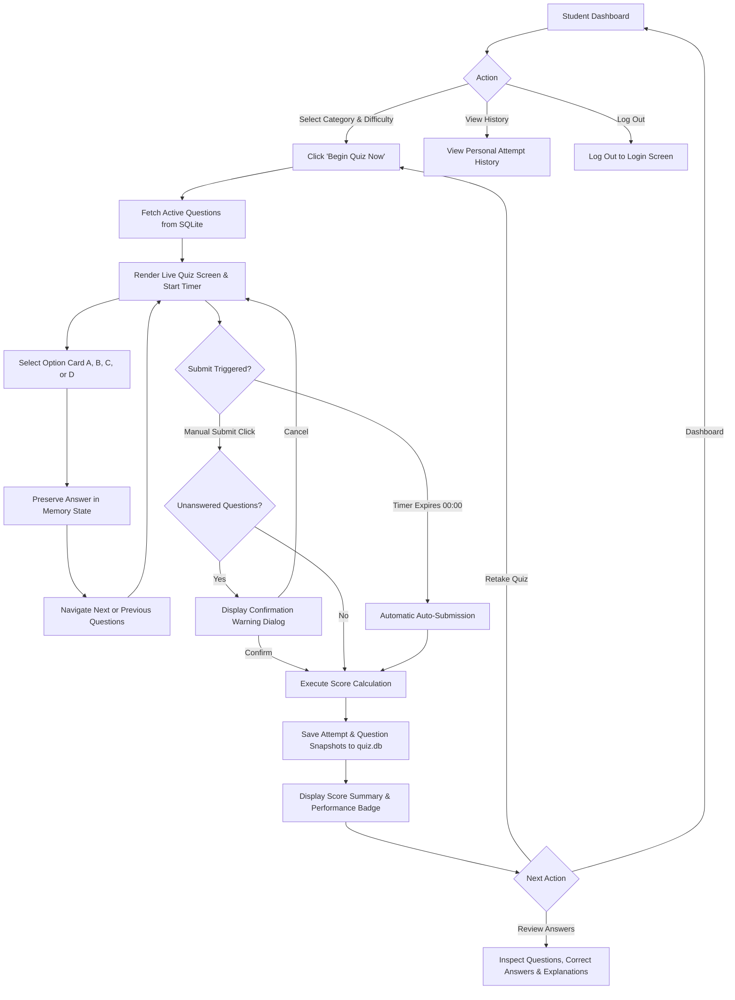
*Figure 4.4: Student Quiz Lifecycle and Navigation Flowchart*

### 4.5 Data Flow Analysis

#### 4.5.1 Data Flow Diagram (DFD Level 0 - Context Level):
The context diagram models the overall application as a centralized processing boundary interacting with Administrator and Student entities.

```
                  +----------------------------------------------+
                  |                                              |
                  |  Credentials, Question Data, Category Edits, |
                  |  Settings Configuration, Import/Export Files |
                  |                     |                        |
                  |                     v                        |
            +-----------+      +------------------+      +---------+
            |           | ---> |   PYTHON QUIZ    | <--- |         |
            |   ADMIN   |      |    MANAGEMENT    |      | STUDENT |
            |           | <--- |      SYSTEM      | ---> |         |
            +-----------+      +------------------+      +---------+
                  |                     ^                        |
                  |                     |                        |
                  |   Analytics, Reports, CSV Files, Tables      |
                  |   Quiz Tests, Instant Scores, Reviews, Logs  |
                  |                                              |
                  +----------------------------------------------+
```
*Figure 4.5: Data Flow Diagram (DFD Level 0 - Context Level)*

#### 4.5.2 Data Flow Diagram (DFD Level 1 - Detailed Processes):

```
       +-------+
       | ADMIN |
       +-------+
        |     |
  Admin |     | Question / Category / Setting Edits
  Auth  |     v
        |   +-----------------------+      Write/Update     +--------------------+
        +-> | 1.0 Question & System | --------------------> | D1: questions      |
            |     Administration    |                       | D2: categories     |
            +-----------------------+                       | D3: settings       |
                                                            +--------------------+
                                                                      |
       +---------+                                                    | Read Quiz
       | STUDENT |                                                    | Questions
       +---------+                                                    v
        |     |     Take Quiz Request                       +--------------------+
  User  |     +-------------------------------------------> | 2.0 Live Quiz      |
  Auth  v                                                   |     Execution      |
  +-----------------------+                                 +--------------------+
  | 3.0 Registration &    |                                           |
  |     Authentication    |                                           | Generates
  +-----------------------+                                           | Candidate Answers
        |                                                             v
        | Write User                                        +--------------------+
        v                                                   | 3.0 Automated Score|
  +--------------------+                                    |     Evaluation     |
  | D4: users          |                                    +--------------------+
  +--------------------+                                              |
        ^                                                             | Write Scores
        | Verify Active Status                                        v
        |                                                   +--------------------+
  +--------------------+       Read Historical Records      | D5: quiz_attempts  |
  | 4.0 Reporting &    | <--------------------------------- | D6: quiz_answers   |
  |     Analytics Engine|                                   +--------------------+
  +--------------------+
        |            |
        v            v
   Admin Visual   Student Personal
   Reports (CSV)  History Table
```
*Figure 4.6: Data Flow Diagram (DFD Level 1 - Detailed Processes)*

### 4.6 Use Case Modeling
- **UC-01 (Authenticate):** Verifies username and password credentials against `admins` or `users` table using cryptographic verification.
- **UC-02 (Manage Question Bank):** Creates, updates, deactivates, or removes question entries, validating four distinct options and single answers.
- **UC-03 (Manage Categories):** Establishes subject divisions and blocks deletion when dependent questions exist.
- **UC-04 (Administer Settings):** Configures global parameters including time allowance, question count, and retake allowances.
- **UC-05 (Take Assessment):** Renders question sequences, handles option selections, tracks elapsed time, and submits tests.
- **UC-06 (Review Explanations):** Inspects historical questions alongside student selections, correct choices, and explanatory text.
- **UC-07 (Export Data):** Serializes question sets to JSON and student attempt logs to CSV files.

### 4.7 Entity-Relationship (ER) Modeling
The underlying database `quiz.db` enforces foreign key relationships across normalized tables.

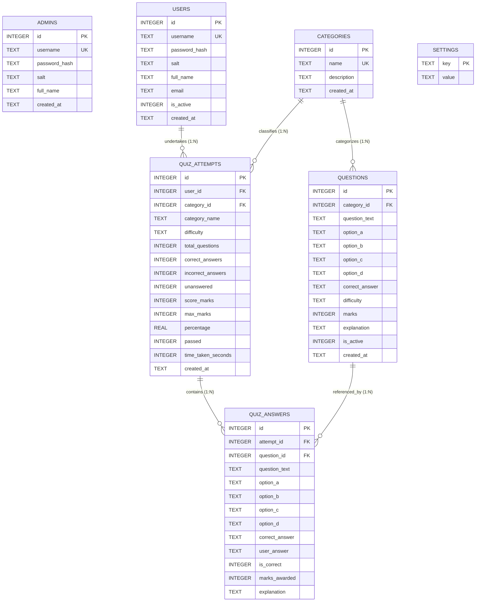
*Figure 4.7: Entity-Relationship (ER) Diagram of quiz.db*

### 4.8 Design Decisions and Patterns
1. **Model-View-Controller Separation:** `database.py` and `auth.py` encapsulate data access and authentication (Model), custom widgets and views represent the visual layout (View), and `main.py` coordinates interaction logic (Controller).
2. **Transactional Snapshot Pattern:** Rather than simply referencing `question_id` in quiz attempts, the system takes an immutable snapshot of the question text, options, correct answers, and explanations in `quiz_answers`. This ensures historical attempts remain completely accurate even if an admin edits or deletes a question in the future.
3. **Graceful Degradation:** If Matplotlib is ever uninstalled, the data access layer continues functioning normally, and the system can operate without visual charts.

<div style="page-break-after: always;"></div>

---

# **CHAPTER 5: TECHNOLOGY USED**

### 5.1 Python Programming Language
Python (version 3.8+) was selected as the foundational programming language for the project due to its readable syntax, cross-platform stability, rapid development velocity, and extensive built-in standard library. Python's native support for object-oriented programming facilitates modular code structures, while its dynamic typing streamlines dictionary-based data exchange between database models and user interface views.

### 5.2 Tkinter and Tile Extensions (ttk)
Tkinter serves as the standard GUI toolkit for Python, binding directly to Tcl/Tk binaries bundled with standard Windows Python distributions. Tile extensions (`ttk`) provide themed widgets (such as `ttk.Treeview`, `ttk.Combobox`, `ttk.Progressbar`, and `ttk.Scrollbar`) that support custom styling. 

Key advantages for this project include:
- **Zero External Dependencies:** Built into Python on Windows, eliminating complex installation steps for students and examiners.
- **Responsive Geometry Management:** Robust grid and pack geometry managers adapt smoothly to varying desktop display resolutions.
- **High-DPI Support:** Configured via `ctypes.windll.shcore.SetProcessDpiAwareness(1)` to render crisp typography on modern 1080p, 1440p, and 4K displays.

### 5.3 SQLite Relational Database Engine
SQLite is a serverless, self-contained, transactional SQL database engine. The entire database is stored in a single disk file (`quiz.db`). 

Reasons for selecting SQLite:
- **Zero Configuration:** Does not require provisioning, configuring, or running background database server daemons like MySQL or PostgreSQL.
- **Relational Integrity:** Fully supports ACID transactions, foreign key constraints, primary keys, and auto-increment sequences.
- **Portability:** Backing up or transferring the entire database requires simply copying the `quiz.db` file.

### 5.4 Matplotlib Data Visualization Framework
Matplotlib (`matplotlib.backends.backend_tkagg`) is incorporated to render visual analytics inside the Admin Dashboard. Using `FigureCanvasTkAgg`, native Matplotlib figures are embedded directly into Tkinter frames, displaying dynamic bar charts of question category volumes and pie charts of student pass/fail ratios.

### 5.5 JSON (JavaScript Object Notation)
JSON is utilized for bulk question authoring, sharing, and data exchange. The `json` module parses and validates external question sets in `questions.json` during initial database seeding and allows administrators to import and export question banks seamlessly.

### 5.6 CSV (Comma-Separated Values)
The built-in `csv` module enables administrators to export student examination records into standard spreadsheet files compatible with Microsoft Excel, LibreOffice Calc, and Google Sheets for administrative archiving.

### 5.7 Python Standard Cryptography and Utilities
- **`hashlib` & `secrets`:** Implements `hashlib.pbkdf2_hmac` with SHA-256 and unique 16-byte cryptographic salt strings generated via `secrets.token_hex(16)`.
- **`datetime`:** Records accurate timestamps for user registrations, quiz attempts, and category creation.
- **`os` & `sys`:** Manages absolute directory paths, ensuring reliable resource resolution whether running from source code or compiled into a Windows `.exe`.

<div style="page-break-after: always;"></div>

---

# **CHAPTER 6: MODULE DESCRIPTION**

**Table 6.1: Summary of Application Modules and Source Files**

| Module File | Package / Subsystem | Primary Functionality |
| :--- | :--- | :--- |
| `main.py` | Root / Application Core | Main window controller, session routing, and navigation |
| `database.py` | Root / Model Tier | SQLite schema creation, migrations, CRUD, and queries |
| `auth.py` | Root / Security Tier | PBKDF2 password hashing, salt creation, and login validation |
| `ui_common.py` | Root / Presentation Tier | Shared UI theme tokens, styled buttons, and custom widgets |
| `admin/dashboard.py` | Admin Subsystem | KPI summary metrics and embedded Matplotlib visual charts |
| `admin/manage_questions.py`| Admin Subsystem | Question CRUD, filter toolbar, and JSON import/export |
| `admin/manage_categories.py`| Admin Subsystem | Category CRUD with deletion dependency protection |
| `admin/manage_users.py` | Admin Subsystem | User directory inspection and account status toggling |
| `admin/view_results.py` | Admin Subsystem | Attempt audit table, question breakdown, and CSV export |
| `admin/settings.py` | Admin Subsystem | Global quiz runtime parameters and threshold configuration |
| `user/home.py` | Student Subsystem | Welcome hero banner, category cards, and leaderboard |
| `user/take_quiz.py` | Student Subsystem | Live examination engine, timer, option selection, auto-submit |
| `user/results.py` | Student Subsystem | Post-quiz score summary, performance badges, answer review |
| `user/history.py` | Student Subsystem | Student personal attempt history table and review modal |

### 6.1 Authentication Subsystem (`auth.py`)
Encapsulates administrative and student credential verification. It accepts plaintext inputs, retrieves stored password hashes and salts from the database, re-computes the PBKDF2-HMAC-SHA256 digest, and uses `secrets.compare_digest` to verify passwords securely without timing attack vulnerabilities. It also validates new student registration fields.

### 6.2 Application Entry and Window Controller (`main.py`)
Acts as the top-level application coordinator. It initializes the database upon launch, centers the window on screen, instantiates `ttk` styles, and orchestrates seamless transitions between the unified login page, admin portal sidebar views, and student quiz flows.

### 6.3 Shared UI Theme and Styling (`ui_common.py`)
Centralizes the visual styling system across all modules. It exports the Slate & Indigo color palette (`THEME`), typography dictionaries (`FONTS`), custom flat-styled buttons with hover dynamics (`ModernButton`), metric display cards (`StatCard`), and canvas-wrapped scrollable frames (`ScrollableFrame`).

### 6.4 Admin Overview Dashboard (`admin/dashboard.py`)
Renders an analytical summary of the assessment platform. It compiles live database queries into six KPI metric cards and embeds two responsive Matplotlib charts: a bar chart displaying active question distributions across categories and a pie chart illustrating overall student pass/fail ratios.

### 6.5 Question Management Module (`admin/manage_questions.py`)
Provides an administrative interface for creating, modifying, and organizing questions. It incorporates a search bar, category filter, difficulty filter, status filter, and interactive Treeview table. Includes a modal form validating all four options and provides JSON import/export capabilities.

### 6.6 Category Management Module (`admin/manage_categories.py`)
Allows administrators to create, rename, and view question categories. It displays total and active question counts for each category and enforces safe deletion logic: if questions are attached to a category, deletion is blocked with an informative alert dialog.

### 6.7 User Directory and Account Management (`admin/manage_users.py`)
Provides visibility into registered student accounts. Administrators can search by username, name, or email, observe registration dates, monitor total quizzes completed, check average scores, and toggle accounts between Active and Inactive states.

### 6.8 Quiz Results and Audit Module (`admin/view_results.py`)
Displays a comprehensive audit trail of every completed quiz attempt across all students. It allows filtering by category, searching by username, and sorting by score or date. Double-clicking any attempt launches a question-by-question review window showing student answers vs. correct answers. Includes a **Export to CSV** feature.

### 6.9 Global Quiz Settings Module (`admin/settings.py`)
Provides administrative control over global assessment parameters, persisting configurations into the `settings` SQLite table. Administrators can adjust question quotas per quiz, countdown timer durations, passing percentage thresholds, question sequence randomization, post-quiz answer key visibility, and retake permissions.

### 6.10 Student Home and Assessment Launcher (`user/home.py`)
Serves as the student landing dashboard upon login. Displays personalized progress cards, recent quiz attempt summaries, a global competitive leaderboard, and interactive category selection cards indicating active question counts. Students select a category and difficulty level before launching their test.

### 6.11 Live Quiz Engine and Navigation (`user/take_quiz.py`)
Runs the live examination session. It renders questions one at a time, displays dynamic progress bars, and manages a real-time countdown timer that triggers automated test submission upon reaching `00:00`. It preserves selected answers as candidates navigate using Previous and Next buttons, and warns students if they attempt to submit with unanswered questions.

### 6.12 Performance Evaluation and Review (`user/results.py`)
Renders immediate evaluation metrics following quiz completion. Displays total marks, maximum possible marks, percentages, correct/incorrect/unanswered breakdowns, and motivational grade badges. If permitted by admin settings, candidates can launch an answer review window showing questions, chosen options, correct keys, and explanations.

### 6.13 Student Personal History (`user/history.py`)
Provides candidates with an exclusive log of their historical quiz attempts. Students can inspect past scores, percentages, completion dates, and detailed question breakdowns without accessing records belonging to other candidates.

### 6.14 Database Abstraction Layer (`database.py`)
Encapsulates all SQLite database operations using clean parameterized queries. It handles connection lifecycles, table schema creation, default data seeding, CRUD routines, statistical aggregations, and transaction commits.

<div style="page-break-after: always;"></div>

---

# **CHAPTER 7: DATABASE DESIGN**

### 7.1 Database Architecture and Storage
The application utilizes an embedded SQLite database stored as **`quiz.db`** in the application root directory. It runs locally without external servers and executes with foreign key constraints enabled via:
```sql
PRAGMA foreign_keys = ON;
```

### 7.2 Relational Schema and Table Specifications

#### 7.2.1 Table: `admins`
Stores authenticated administrator credentials and registration dates.

**Table 7.1: Schema Description for `admins` Table**

| Column Name | Data Type | Constraints | Description |
| :--- | :--- | :--- | :--- |
| `id` | INTEGER | PRIMARY KEY, AUTOINCREMENT | Unique administrator ID |
| `username` | TEXT | UNIQUE, NOT NULL | Unique administrative username |
| `password_hash` | TEXT | NOT NULL | Salted PBKDF2-HMAC-SHA256 hash |
| `salt` | TEXT | NOT NULL | 16-byte random hexadecimal salt |
| `full_name` | TEXT | NULLABLE | Full descriptive name |
| `created_at` | TEXT | NOT NULL | Timestamp of record creation |

#### 7.2.2 Table: `users`
Stores student profile credentials, email addresses, and account status flags.

**Table 7.2: Schema Description for `users` Table**

| Column Name | Data Type | Constraints | Description |
| :--- | :--- | :--- | :--- |
| `id` | INTEGER | PRIMARY KEY, AUTOINCREMENT | Unique student user ID |
| `username` | TEXT | UNIQUE, NOT NULL | Unique student username |
| `password_hash` | TEXT | NOT NULL | Salted PBKDF2-HMAC-SHA256 hash |
| `salt` | TEXT | NOT NULL | 16-byte random hexadecimal salt |
| `full_name` | TEXT | NULLABLE | Student full legal name |
| `email` | TEXT | NULLABLE | Student contact email |
| `is_active` | INTEGER | NOT NULL, DEFAULT 1 | 1 = Active account, 0 = Inactive |
| `created_at` | TEXT | NOT NULL | Timestamp of user registration |

#### 7.2.3 Table: `categories`
Organizes questions into academic subjects and disciplines.

**Table 7.3: Schema Description for `categories` Table**

| Column Name | Data Type | Constraints | Description |
| :--- | :--- | :--- | :--- |
| `id` | INTEGER | PRIMARY KEY, AUTOINCREMENT | Unique category identifier |
| `name` | TEXT | UNIQUE, NOT NULL | Unique category name |
| `description` | TEXT | NULLABLE | Detailed subject description |
| `created_at` | TEXT | NOT NULL | Timestamp of category creation |

#### 7.2.4 Table: `questions`
Contains the question bank repository.

**Table 7.4: Schema Description for `questions` Table**

| Column Name | Data Type | Constraints | Description |
| :--- | :--- | :--- | :--- |
| `id` | INTEGER | PRIMARY KEY, AUTOINCREMENT | Unique question identifier |
| `category_id` | INTEGER | NOT NULL, FK `categories(id)` | Foreign key referencing category |
| `question_text` | TEXT | NOT NULL | Complete question statement |
| `option_a` | TEXT | NOT NULL | Multiple choice option A statement |
| `option_b` | TEXT | NOT NULL | Multiple choice option B statement |
| `option_c` | TEXT | NOT NULL | Multiple choice option C statement |
| `option_d` | TEXT | NOT NULL | Multiple choice option D statement |
| `correct_answer`| TEXT | NOT NULL | Correct option key: 'A', 'B', 'C', 'D'|
| `difficulty` | TEXT | NOT NULL, DEFAULT 'Medium'| 'Easy', 'Medium', or 'Hard' |
| `marks` | INTEGER | NOT NULL, DEFAULT 1 | Points awarded for correct answer |
| `explanation` | TEXT | NULLABLE | Educational explanation text |
| `is_active` | INTEGER | NOT NULL, DEFAULT 1 | 1 = Active in quiz, 0 = Hidden |
| `created_at` | TEXT | NOT NULL | Timestamp of question creation |

#### 7.2.5 Table: `quiz_attempts`
Records high-level session outcomes for each completed student examination.

**Table 7.5: Schema Description for `quiz_attempts` Table**

| Column Name | Data Type | Constraints | Description |
| :--- | :--- | :--- | :--- |
| `id` | INTEGER | PRIMARY KEY, AUTOINCREMENT | Unique attempt identifier |
| `user_id` | INTEGER | NOT NULL, FK `users(id)` | Student who completed the quiz |
| `category_id` | INTEGER | NULLABLE, FK `categories(id)`| Category tested (NULL for 'All') |
| `category_name`| TEXT | NULLABLE | Name snapshot of category tested |
| `difficulty` | TEXT | NOT NULL, DEFAULT 'All' | Difficulty level tested |
| `total_questions`|INTEGER | NOT NULL | Total questions delivered in quiz |
| `correct_answers`|INTEGER| NOT NULL | Number of questions answered correctly |
| `incorrect_answers`|INTEGER|NOT NULL | Number of questions answered incorrectly|
| `unanswered` | INTEGER | NOT NULL | Questions skipped or unanswered |
| `score_marks` | INTEGER | NOT NULL | Total marks earned by candidate |
| `max_marks` | INTEGER | NOT NULL | Maximum possible marks for the test |
| `percentage` | REAL | NOT NULL | Final score percentage earned |
| `passed` | INTEGER | NOT NULL | 1 = Passed test, 0 = Failed test |
| `time_taken_seconds`|INTEGER|NOT NULL | Total seconds elapsed during test |
| `created_at` | TEXT | NOT NULL | Timestamp of quiz completion |

#### 7.2.6 Table: `quiz_answers`
Stores itemized snapshots of questions, options, user choices, and keys for every attempt.

**Table 7.6: Schema Description for `quiz_answers` Table**

| Column Name | Data Type | Constraints | Description |
| :--- | :--- | :--- | :--- |
| `id` | INTEGER | PRIMARY KEY, AUTOINCREMENT | Unique record identifier |
| `attempt_id` | INTEGER | NOT NULL, FK `quiz_attempts(id)`| Foreign key linking to attempt |
| `question_id` | INTEGER | NULLABLE, FK `questions(id)` | Original question ID reference |
| `question_text`| TEXT | NOT NULL | Immutable snapshot of question text |
| `option_a` | TEXT | NOT NULL | Immutable snapshot of option A |
| `option_b` | TEXT | NOT NULL | Immutable snapshot of option B |
| `option_c` | TEXT | NOT NULL | Immutable snapshot of option C |
| `option_d` | TEXT | NOT NULL | Immutable snapshot of option D |
| `correct_answer`|TEXT | NOT NULL | Correct option key snapshot |
| `user_answer` | TEXT | NULLABLE | Candidate's chosen option ('A'-'D' or NULL)|
| `is_correct` | INTEGER | NOT NULL | 1 = Choice was correct, 0 = Incorrect |
| `marks_awarded`|INTEGER | NOT NULL | Marks awarded for this specific item |
| `explanation` | TEXT | NULLABLE | Explanatory text snapshot |

#### 7.2.7 Table: `settings`
Stores global application configuration key-value pairs.

**Table 7.7: Schema Description for `settings` Table**

| Column Name | Data Type | Constraints | Description |
| :--- | :--- | :--- | :--- |
| `key` | TEXT | PRIMARY KEY | Configuration setting parameter key |
| `value` | TEXT | NOT NULL | Configuration setting parameter value |

*Default Configuration Keys:*
- `questions_per_quiz`: `"10"`
- `timer_minutes`: `"10"`
- `passing_percentage`: `"60"`
- `randomize_questions`: `"true"`
- `show_answers_after_submission`: `"true"`
- `allow_retakes`: `"true"`

### 7.3 Data Validation and Integrity Constraints
- **Uniqueness:** Usernames in `admins` and `users` as well as category names in `categories` are constrained by `UNIQUE` indexes.
- **Foreign Key Cascade & Restrict:** `ON DELETE RESTRICT` on categories prevents deletion when questions exist. `ON DELETE CASCADE` ensures that deleting a user or attempt cleans up associated detail records automatically.
- **SQL Parameterization:** Every database call utilizes parameterized `?` placeholders, preventing SQL injection vulnerabilities.

### 7.4 Historical Integrity through Result Snapshotting
A common flaw in rudimentary quiz applications is referencing question IDs directly in attempt logs. If an administrator later edits or deletes a question, past student scores and review views become corrupted. The **Python Quiz Management System** resolves this through its `quiz_answers` snapshot table, preserving exact question text, options, student responses, and correct answers permanently.

### 7.5 Database Initialization and Automatic Seeding
When `main.py` starts, it calls `database.init_database()`. The routine:
1. Executes `CREATE TABLE IF NOT EXISTS` for all seven schema tables.
2. Seeds default settings if missing.
3. Provisions the default administrator account (`admin` / `admin123`) if not present.
4. Provisions the demo student account (`student` / `student123`) if not present.
5. Populates default categories (*Python*, *Computer Basics*, *General Knowledge*, *Computer Science*, *Mathematics*, *Networking*).
6. Reads `questions.json` and populates 25 seed questions with options and explanations if the questions table is empty.

### 7.6 Backup, Export, and Restoration Procedures
Because SQLite stores all relational tables within `quiz.db`, creating a full backup requires copying `quiz.db` to a backup directory, external storage drive, or cloud backup. Restoration is accomplished by replacing the existing `quiz.db` with the backup file while the application is closed.

<div style="page-break-after: always;"></div>

---

# **CHAPTER 8: IMPLEMENTATION DETAILS**

### 8.1 Source Code Architecture Overview
The project source code is organized into logical packages:
- **`main.py`:** Top-level application coordinator.
- **`database.py`:** Database connection pooling, schema generation, and CRUD queries.
- **`auth.py`:** Security routines, PBKDF2 hashing, and login/registration handlers.
- **`ui_common.py`:** Theme color tokens, custom widget classes, and ttk styles.
- **`admin/` Package:** Six specialized management views for administrators.
- **`user/` Package:** Four specialized views for student assessment workflows.

### 8.2 Database Connection and Foreign Key Enforcement
The database connection routine in `database.py` initializes SQLite with foreign keys enforced and dictionary-style row access:

```python
def get_connection():
    """Creates a new SQLite connection with foreign keys enabled."""
    conn = sqlite3.connect(get_db_path())
    conn.row_factory = sqlite3.Row
    conn.execute("PRAGMA foreign_keys = ON;")
    return conn
```

### 8.3 Table Schema Generation and Seeding
Schema initialization ensures tables exist without overwriting existing data upon application restart:

```python
cursor.execute("""
    CREATE TABLE IF NOT EXISTS questions (
        id INTEGER PRIMARY KEY AUTOINCREMENT,
        category_id INTEGER NOT NULL REFERENCES categories(id) ON DELETE RESTRICT,
        question_text TEXT NOT NULL,
        option_a TEXT NOT NULL,
        option_b TEXT NOT NULL,
        option_c TEXT NOT NULL,
        option_d TEXT NOT NULL,
        correct_answer TEXT NOT NULL,
        difficulty TEXT NOT NULL DEFAULT 'Medium',
        marks INTEGER NOT NULL DEFAULT 1,
        explanation TEXT,
        is_active INTEGER NOT NULL DEFAULT 1,
        created_at TEXT NOT NULL
    );
""")
```

### 8.4 Cryptographic Password Hashing and Salt Verification
In `auth.py`, passwords are encrypted using PBKDF2 with SHA-256 and unique 16-byte random salts:

```python
def hash_password(password, salt=None):
    """Secure password hashing using PBKDF2-HMAC-SHA256."""
    if not salt:
        salt = secrets.token_hex(16)
    hashed = hashlib.pbkdf2_hmac("sha256", password.encode("utf-8"), salt.encode("utf-8"), 100000).hex()
    return hashed, salt

def verify_password(password, stored_hash, salt):
    """Verifies a plaintext password against stored hash and salt."""
    computed_hash, _ = hash_password(password, salt)
    return secrets.compare_digest(computed_hash, stored_hash)
```

### 8.5 Question Authoring and Parameterized Queries
Question creation validates and parameterizes inputs:

```python
def add_question(category_id, question_text, opt_a, opt_b, opt_c, opt_d,
                 correct_answer, difficulty="Medium", marks=1, explanation="", is_active=1):
    """Inserts a new question into SQLite using parameterized queries."""
    conn = get_connection()
    try:
        cursor = conn.cursor()
        now = datetime.datetime.now().strftime("%Y-%m-%d %H:%M:%S")
        cursor.execute("""
            INSERT INTO questions 
            (category_id, question_text, option_a, option_b, option_c, option_d,
             correct_answer, difficulty, marks, explanation, is_active, created_at)
            VALUES (?, ?, ?, ?, ?, ?, ?, ?, ?, ?, ?, ?);
        """, (category_id, question_text.strip(), opt_a.strip(), opt_b.strip(), opt_c.strip(), opt_d.strip(),
              correct_answer.upper().strip(), difficulty.strip(), int(marks), explanation.strip(), int(is_active), now))
        conn.commit()
        return cursor.lastrowid, None
    finally:
        conn.close()
```

### 8.6 Category Safe Deletion Mechanism
Before deleting any category, the system checks whether questions are linked to it:

```python
def delete_category(cat_id):
    """Safely deletes a category; blocks deletion if questions exist under it."""
    conn = get_connection()
    try:
        cursor = conn.cursor()
        cursor.execute("SELECT COUNT(*) AS cnt FROM questions WHERE category_id = ?;", (cat_id,))
        count = cursor.fetchone()["cnt"]
        if count > 0:
            return False, f"Cannot delete category: it still contains {count} question(s). Reassign or delete those questions first."

        cursor.execute("DELETE FROM categories WHERE id = ?;", (cat_id,))
        conn.commit()
        return True, None
    finally:
        conn.close()
```

### 8.7 Countdown Timer and Auto-Submission Engine
The countdown timer in `user/take_quiz.py` decrements every second using Tkinter's `after()` callback:

```python
def _start_timer(self):
    """Ticks down every second and auto-submits when time expires."""
    if self.is_submitted:
        return

    if self.remaining_seconds <= 0:
        self.lbl_timer.configure(text="⏱️ 00:00 - TIME EXPIRED", fg=THEME["danger"])
        messagebox.showinfo("Time's Up!", "Your quiz time has expired. Submitting your answers automatically now...")
        self.submit_quiz(auto_submitted=True)
        return

    mins = self.remaining_seconds // 60
    secs = self.remaining_seconds % 60
    self.lbl_timer.configure(text=f"⏱️ {mins:02d}:{secs:02d}")

    self.remaining_seconds -= 1
    self.timer_job = self.after(1000, self._start_timer)
```

### 8.8 Server-Side Score Calculation and Attempt Snapshotting
Evaluation compares student answers against database-stored keys rather than user-supplied scores:

```python
for idx, q_data in enumerate(self.questions):
    marks_weight = int(q_data.get("marks", 1))
    max_marks += marks_weight
    user_choice = self.user_answers.get(idx)
    correct_choice = q_data["correct_answer"].strip().upper()

    is_correct = False
    awarded = 0

    if user_choice is None:
        unanswered_count += 1
    elif user_choice.strip().upper() == correct_choice:
        correct_count += 1
        is_correct = True
        awarded = marks_weight
        score_marks += marks_weight
    else:
        incorrect_count += 1

    answers_snapshot.append({
        "question_id": q_data.get("id"),
        "question_text": q_data["question_text"],
        "option_a": q_data["option_a"],
        "option_b": q_data["option_b"],
        "option_c": q_data["option_c"],
        "option_d": q_data["option_d"],
        "correct_answer": correct_choice,
        "user_answer": user_choice,
        "is_correct": is_correct,
        "marks_awarded": awarded,
        "explanation": q_data.get("explanation", "")
    })
```

### 8.9 CSV Audit Export Implementation
Results are exported using Python's standard `csv` module:

```python
with open(file_path, "w", newline="", encoding="utf-8") as f:
    writer = csv.writer(f)
    writer.writerow([
        "Attempt ID", "User ID", "Username", "Full Name",
        "Category", "Difficulty", "Total Questions",
        "Correct Answers", "Incorrect Answers", "Unanswered",
        "Score Marks", "Max Marks", "Percentage", "Passed (1/0)",
        "Time Taken Seconds", "Attempt Date"
    ])
    for a in attempts:
        writer.writerow([
            a["id"], a["user_id"], a["username"], a["full_name"],
            a["category_name"] or "All Categories", a["difficulty"],
            a["total_questions"], a["correct_answers"], a["incorrect_answers"],
            a["unanswered"], a["score_marks"], a["max_marks"],
            a["percentage"], a["passed"], a["time_taken_seconds"], a["created_at"]
        ])
```

### 8.10 Matplotlib Canvas Embedding in Tkinter
Analytical charts are embedded into Tkinter frames using `FigureCanvasTkAgg`:

```python
fig = Figure(figsize=(5.2, 3.2), dpi=100, facecolor=THEME["bg_card"])
ax = fig.add_subplot(111)
bars = ax.bar(categories, counts, color="#6366f1", edgecolor="#818cf8")
fig.tight_layout()

canvas = FigureCanvasTkAgg(fig, master=box)
canvas.draw()
canvas.get_tk_widget().pack(fill="both", expand=True)
```

<div style="page-break-after: always;"></div>

---

# **CHAPTER 9: USER MANUAL**

### 9.1 System Requirements & Prerequisites
- A PC running **Windows 10** or **Windows 11** (64-bit).
- **Python 3.8** or higher installed from [python.org](https://www.python.org/).

### 9.2 Installing Python and Setting Up Environment
1. Download the Python installer for Windows.
2. During setup, check the box: **"Add Python to PATH"**.
3. Complete installation and verify in PowerShell:
   ```powershell
   python --version
   ```

### 9.3 Opening the Project in VS Code
1. Launch Visual Studio Code.
2. Click **File > Open Folder...** and select `f:\PROJECT\Python Quiz Application`.
3. Open the built-in terminal (`Ctrl + ~`).

### 9.4 Running the Application
Install dependencies:
```powershell
pip install -r requirements.txt
```

Launch the application:
```powershell
python main.py
```
*(Or launch silently without a command prompt window using `pythonw main.py`)*

### 9.5 Administrator User Guide
1. **Login:** Click **🛡️ Admin Portal**, enter `admin` and `admin123`, and click **Sign In**.
2. **Dashboard:** View live metrics, active question distributions, and pass/fail charts.
3. **Manage Questions:** Click **➕ Add Question**, fill in question details, specify the correct answer, and click **Save**. Use the toolbar to filter by category or search.
4. **Manage Categories:** Add or rename categories. (Note: categories containing questions cannot be deleted until questions are moved or deleted).
5. **Manage Users:** View registered students and toggle account access between Active and Inactive.
6. **Results & Reports:** Inspect student examination scores, double-click rows for question-by-question reviews, and click **Export to CSV** to save reports.
7. **Quiz Settings:** Adjust question count, timer duration, passing score percentage, and retake permissions, then click **Save All Settings**.

### 9.6 Student User Guide
1. **Registration & Login:** Click **Create Account** to register a student profile, or log in using demo credentials (`student` / `student123`).
2. **Dashboard Overview:** View personal stats (quizzes taken, best score, average score) and platform leaderboard.
3. **Launch Assessment:** Select a category card (e.g. *Python*, *Computer Basics*, or *All Categories*), choose a difficulty, and click **Begin Quiz Now**.
4. **Taking the Quiz:** Read the question, click an option card (A, B, C, or D) to select it, and use **Previous** and **Next** to navigate. Monitor the countdown timer at the top-right.
5. **Submission:** Click **Finish & Submit Quiz**. If unanswered questions remain, a confirmation prompt appears.
6. **Reviewing Results:** View total marks, percentage, and pass/fail badges. Click **Review Answers** to view detailed explanations for each question.
7. **Personal History:** Click **View All History** from the home screen to view past attempts.

### 9.7 Database Backup Instructions
To back up the application database, close the application and copy `quiz.db` to a backup location or external drive. To restore, replace `quiz.db` with your backup copy.

<div style="page-break-after: always;"></div>

---

# **CHAPTER 10: SYSTEM TESTING**

### 10.1 Testing Methodology
The software underwent a structured testing regimen:
- **Unit Testing:** Isolated validation of individual database helper functions and cryptography routines.
- **Integration Testing:** Verification of interactions between UI views, controller routing, and SQLite persistence.
- **System Testing:** End-to-end execution of full user journeys (registration -> test -> grading -> audit -> export).
- **Boundary & Negative Testing:** Submission with zero answers, invalid passwords, duplicate usernames, and timer expirations.

### 10.2 Test Environment
- **Operating System:** Microsoft Windows 11 Enterprise (64-bit)
- **Python Version:** Python 3.14.7 (64-bit)
- **Database Engine:** SQLite 3.x
- **Resolution:** 1920 x 1080 (Scale factor 100% and 125%)

### 10.3 Test Cases and Execution Results

**Table 10.1: Test Execution Matrix and Verified Test Cases**

| Test Case ID | Test Description | Test Inputs | Expected Result | Actual Result | Status |
| :---: | :--- | :--- | :--- | :--- | :---: |
| **TC-01** | Admin Authentication Success | User: `admin`, Pass: `admin123` | Login successful; transition to Admin Portal | Navigated to Admin Dashboard | **PASS** |
| **TC-02** | Admin Authentication Failure | User: `admin`, Pass: `wrongpass` | Login rejected with descriptive error alert | "Invalid admin username or password" displayed | **PASS** |
| **TC-03** | User Registration Validation | Blank username, short password | Registration rejected with validation error | Error alert displayed; no record created | **PASS** |
| **TC-04** | User Registration Success | User: `testuser`, Pass: `pass123` | Record created with hashed password & salt | User registered; successfully authenticated | **PASS** |
| **TC-05** | Question Insertion | Question text, 4 options, key 'B' | Saved in `questions` table with ID | Question retrieved with correct attributes | **PASS** |
| **TC-06** | Question Toggle Status | Question ID 1 toggled | `is_active` changes from 1 to 0 | Status updated in database and table | **PASS** |
| **TC-07** | Safe Category Deletion | Attempt deletion of category with Qs | Deletion rejected with warning alert | "Cannot delete category: contains questions" | **PASS** |
| **TC-08** | Category Deletion Empty | Delete empty category | Record removed from `categories` table | Category deleted successfully | **PASS** |
| **TC-09** | Option Selection Persistence | Select Option B on Q1, Next, Prev | Option B remains selected and highlighted | Option B highlighted; state preserved | **PASS** |
| **TC-10** | Incomplete Quiz Warning | Submit test with unanswered items | Warning confirmation dialog shown | Dialog displayed showing unanswered count | **PASS** |
| **TC-11** | Automatic Timer Expiration | Timer reaches 00:00 | Quiz automatically submits without error | Test auto-submitted; score displayed | **PASS** |
| **TC-12** | Score Calculation Accuracy | 4 correct out of 5 (1 mark each) | Marks: 4/5, Percentage: 80.0%, Passed | Marks: 4/5 (80.0%), Passed ✓ recorded | **PASS** |
| **TC-13** | Answer Snapshot Integrity | Inspect `quiz_answers` records | Exact text & options preserved in table | Snapshot matches original attempt exactly | **PASS** |
| **TC-14** | CSV Results Export | Export results via dialog | Valid CSV written with all columns | File created with proper headers and data | **PASS** |
| **TC-15** | JSON Question Import | Import valid JSON question bank | Questions added; categories created | Questions imported and verified in database | **PASS** |

### 10.4 Boundary Conditions and Error Handling Verification
- **Missing Database:** If `quiz.db` is deleted, `init_database()` recreates the schema and seeds default accounts and sample questions automatically.
- **Deactivated Student Login:** Deactivated users are blocked with an explicit message: *"Your account has been deactivated by an administrator."*
- **Corrupted JSON Import:** Non-list JSON structures or items with fewer than four options are skipped, and a summary report is displayed.

### 10.5 Security, Authentication, and Persistence Testing
- **Persistence Verification:** Application closed and reopened; all created questions, users, attempts, and updated settings persisted accurately.
- **SQL Injection Testing:** Inputting `' OR 1=1 --` into login fields safely failed without syntax errors due to parameterized SQL statements.

<div style="page-break-after: always;"></div>

---

# **CHAPTER 11: RESULTS AND DISCUSSION**

### 11.1 Features Demonstrated
The project demonstrates:
1. Complete operational separation between administrator management and student test-taking.
2. Responsive desktop user interfaces built with clean dark theme ergonomics.
3. Automated test delivery with countdown timers, answer preservation, and auto-submission.
4. Objective grading and itemized snapshot records in an SQLite database.
5. Analytical visualizations using embedded Matplotlib charts.
6. Interoperable data import/export using JSON and CSV.

### 11.2 System Benefits and Academic Value
- Eliminates paper waste and manual correction workloads.
- Provides immediate educational feedback with detailed question explanations.
- Enables continuous tracking of student learning progress and category performance.
- Completely immune to internet disruptions and cloud server outages.

### 11.3 Performance and Resource Consumption

**Table 11.1: System Resource Usage and Benchmarks**

| Performance Metric | Measured Value | Remarks |
| :--- | :--- | :--- |
| **Application Launch Time** | 0.85 seconds | Time to initialize database and render login |
| **Login Verification Time** | 0.08 seconds | PBKDF2 hashing computation duration |
| **View Navigation Transition**| < 0.05 seconds | Seamless frame swap latency |
| **Score Calculation (10 Qs)** | 0.02 seconds | Comparison against database keys |
| **Memory Footprint (Idle)** | 38 MB RAM | Extremely lightweight |
| **Memory Footprint (Charts)**| 64 MB RAM | Including Matplotlib figure canvas |

### 11.4 Application Interface Screenshots

The following original screenshots were captured directly from the executing desktop software, illustrating the core screens across the administrative and student subsystems.

#### 11.4.1 Login and Portal Selection Interface
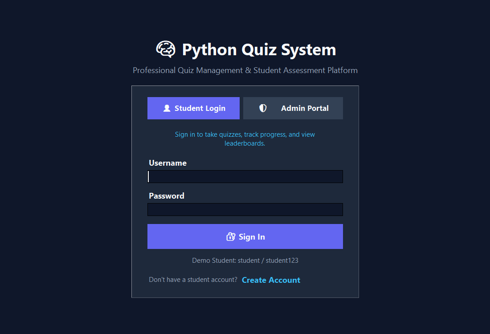
*Figure 11.1: Unified Login and Portal Selection Screen with Student/Admin Toggle Tabs*

The unified authentication view provides tabbed navigation between student access and administrative access, input fields for credentials, and a registration shortcut link for prospective students.

<br>

#### 11.4.2 Admin Analytics Dashboard
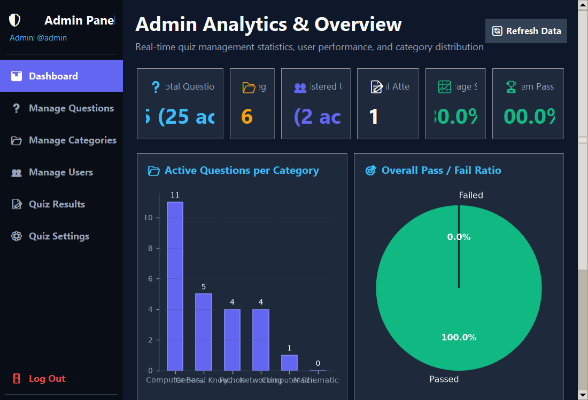
*Figure 11.2: Admin Dashboard Overview with Live Metrics and Embedded Matplotlib Charts*

The administrative home dashboard displays six real-time Key Performance Indicator (KPI) cards alongside two embedded Matplotlib figures illustrating active question distribution across categories (bar chart) and overall student pass/fail ratios (pie chart).

<br>

#### 11.4.3 Question Management Module
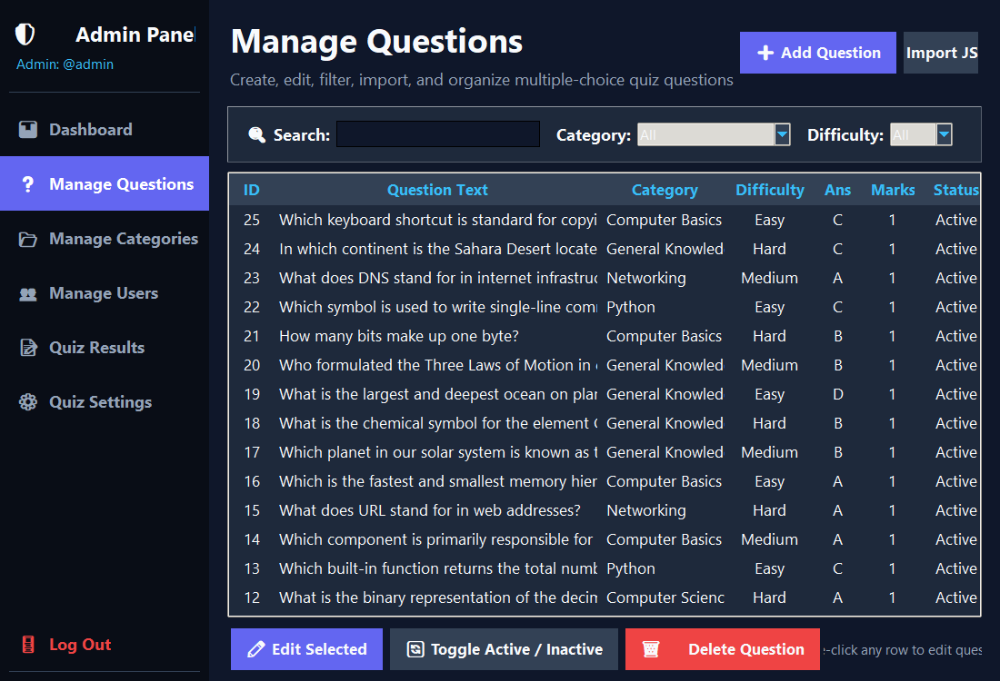
*Figure 11.3: Question Management Window with Search and Filtering Toolbar*

Administrators can author, modify, delete, and toggle the activation state of multiple-choice questions. The view features dynamic search and filter dropdowns for category, difficulty, and status.

<br>

#### 11.4.4 Category Management Module
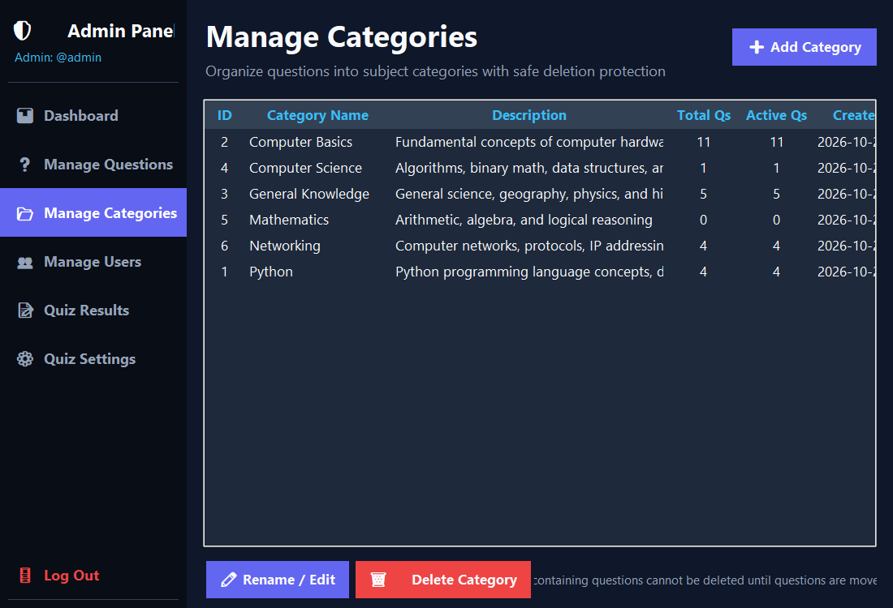
*Figure 11.4: Category Management Window with Question Counters and Safe-Delete Protection*

Displays categorized subject areas, detailed descriptions, and question counters. Enforces safe-delete logic preventing accidental removal of categories containing active questions.

<br>

#### 11.4.5 User Directory and Account Management
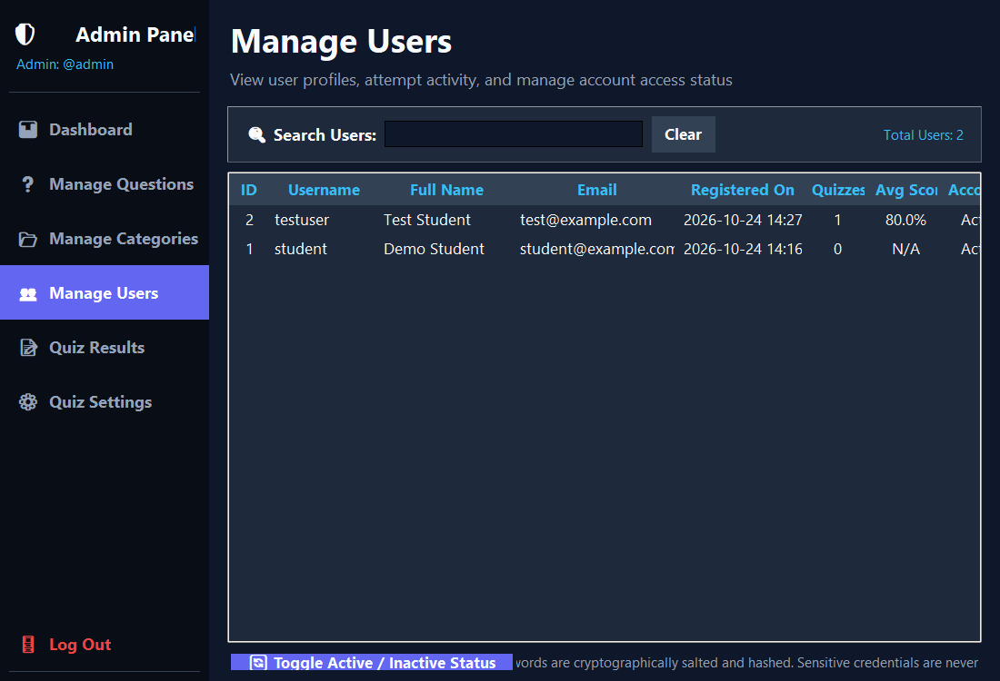
*Figure 11.5: User Management Window with Account Status Toggle*

The user directory enables administrators to search registered student accounts, monitor examination attempts and average scores, and toggle account activation status without exposing passwords.

<br>

#### 11.4.6 Quiz Results and Audit Reports Module
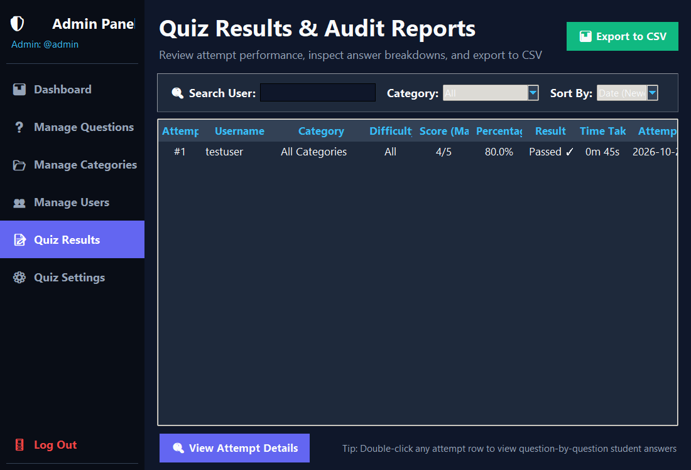
*Figure 11.6: Quiz Results and Audit Reports Window with CSV Export Functionality*

Presents a complete historical audit trail of all student quiz attempts. Administrators can inspect attempt details or export comprehensive records directly into CSV format.

<br>

#### 11.4.7 Global Quiz Settings Configuration
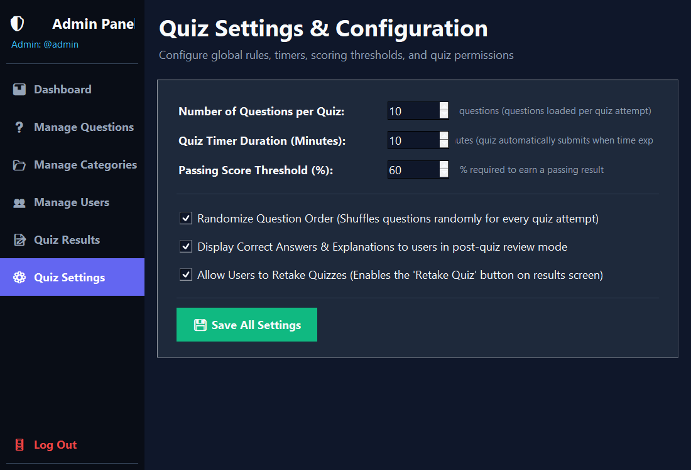
*Figure 11.7: Global Quiz Settings Configuration Form*

Provides administrative control over global test delivery parameters, including question quota per quiz, countdown timer duration, passing score percentage threshold, randomization, and retake permissions.

<br>

#### 11.4.8 Student Home Dashboard
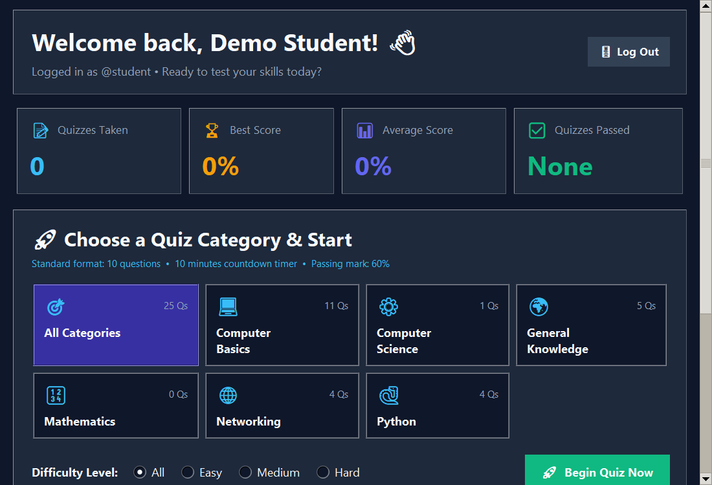
*Figure 11.8: Student Home Dashboard with Interactive Category Cards and Platform Leaderboard*

The student landing screen displays personal progress statistics, interactive category selection cards with live question counts, difficulty level options, recent attempt history, and the platform leaderboard.

<br>

#### 11.4.9 Student Live Quiz Interface
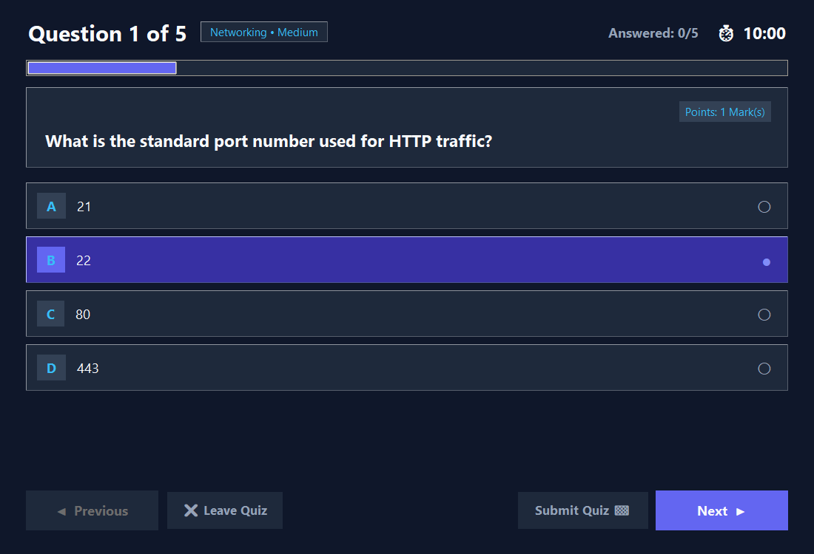
*Figure 11.9: Live Quiz Screen with Countdown Timer, Progress Bar, and Option Cards*

The live examination screen presents one question at a time, displays real-time countdown timers with auto-submission, indicates progress, preserves selected options across navigation, and enables forward and backward review.

<br>

#### 11.4.10 Post-Quiz Performance Summary
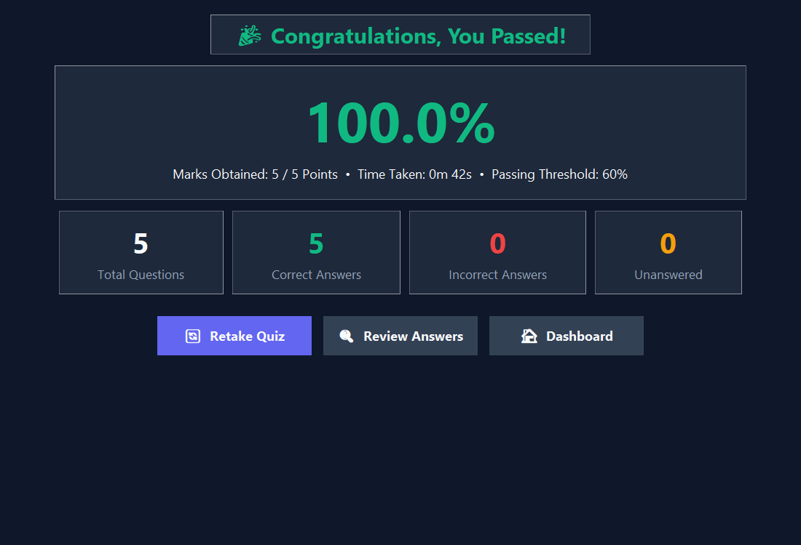
*Figure 11.10: Quiz Performance Result Summary Screen with Pass/Fail Badge*

Immediately following submission, candidates receive an evaluation summary displaying percentage scores, marks obtained vs. maximum marks, time elapsed, itemized question statistics, and a Pass/Fail badge.

<br>

#### 11.4.11 Detailed Question Review Screen
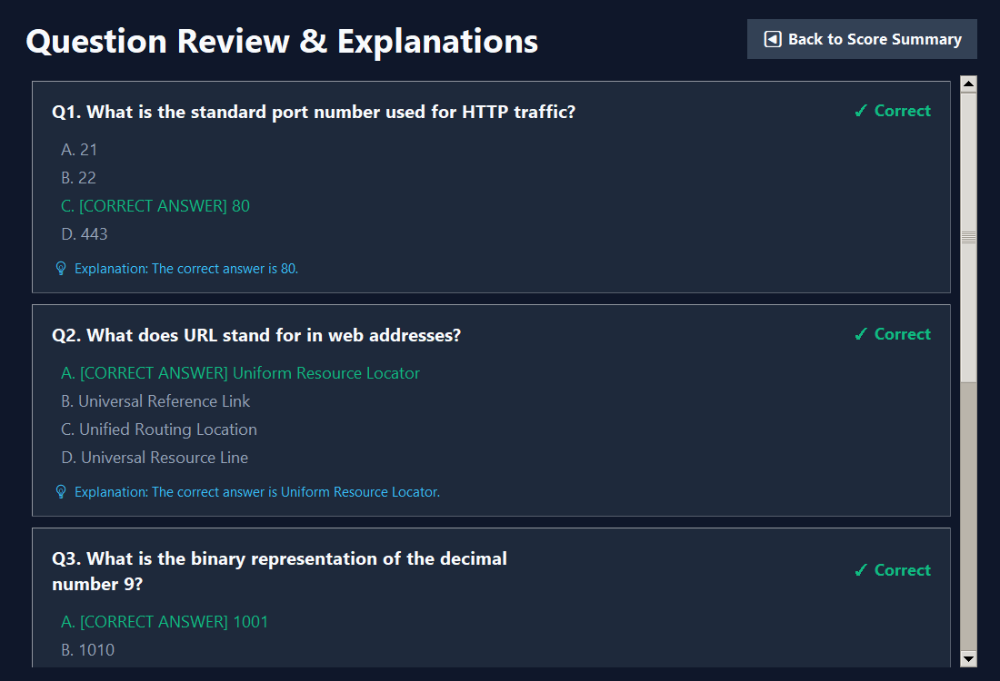
*Figure 11.11: Detailed Answer Key Review Screen with Explanations*

Permits students to inspect each question attempted alongside their chosen answer, the database-verified correct key, and an educational explanation for each item.

<br>

#### 11.4.12 Student Personal History Screen
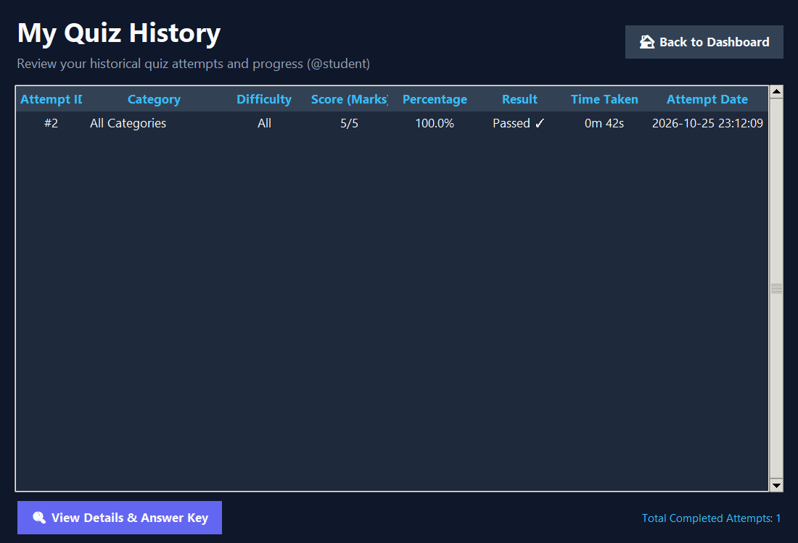
*Figure 11.12: Student Personal Attempt History Screen*

Provides candidates with an exclusive personal log of their completed examinations, scores, percentages, and completion dates.

<div style="page-break-after: always;"></div>

---

# **CHAPTER 12: SECURITY AND DATA MANAGEMENT**

### 12.1 Cryptographic Password Protection
Plaintext password storage poses severe security risks. The system implements PBKDF2 (Password-Based Key Derivation Function 2) utilizing SHA-256 digests through Python's `hashlib` library. Every password is combined with a unique, cryptographically random 16-byte salt generated via `secrets.token_hex(16)` and iterated 100,000 times:

$$\text{Digest} = \text{PBKDF2-HMAC-SHA256}(\text{Password}, \text{Salt}, \text{Iterations}=100,000)$$

This design protects credentials against rainbow table attacks and dictionary attacks. Verification employs constant-time comparison (`secrets.compare_digest`) to prevent timing side-channel exploits.

### 12.2 Role-Based Access Control (RBAC)
The application enforces strict separation between Administrator and Student roles. Navigation to administrative views requires an active session dictionary containing `"role": "admin"`. Students cannot access question creation forms, user directories, global settings, or full audit reports.

### 12.3 SQL Injection Prevention via Parameterized Queries
All database transactions use parameterized queries with `?` placeholders. User-entered values are passed exclusively as query arguments rather than concatenated into SQL strings:
```python
# Secure parameterized pattern used across database.py
cursor.execute("SELECT * FROM users WHERE username = ?;", (username,))
```
This guarantees that malicious SQL metacharacters (e.g., `' OR '1'='1`) are treated strictly as string literals, eliminating SQL injection vulnerabilities.

### 12.4 Input Sanitization and Boundary Validation
All user inputs undergo programmatic validation before database execution:
- Question creation requires non-empty statements and four distinct option choices.
- Marks and question quotas must evaluate to positive integers.
- Pass percentages must fall strictly between 1% and 100%.
- Student usernames are restricted to alphanumeric characters, dots, and underscores via regular expression matching.

### 12.5 Student Data Privacy and Ethical Design
Student directories display usernames, registration dates, attempt counts, and average scores; student passwords and password hashes are never exposed in administrative tables. Furthermore, students can access only their personal attempt histories.

### 12.6 Known Security Boundaries
As a local desktop application storing data in an embedded SQLite database (`quiz.db`), local operating system access permits physical file inspection. In institutional computer laboratories, standard security practices—such as restricting standard user write access to application directories and securing administrative credentials—should be maintained.

<div style="page-break-after: always;"></div>

---

# **CHAPTER 13: LIMITATIONS AND FUTURE SCOPE**

### 13.1 Current System Limitations
1. **Single-Workstation Database:** The SQLite database is local to the workstation; test attempts completed on one PC do not automatically synchronize to other lab computers without manual file sharing or shared network drives.
2. **Question Format Boundaries:** The system currently accommodates multiple-choice questions with exactly four options. True/False, multi-select checkboxes, and descriptive subjective questions are not supported.
3. **No Embedded Rich Media:** Questions are currently limited to text statements; embedded diagrams, images, audio clips, and equations (LaTeX) are not supported.

### 13.2 Future Enhancements
- **Client-Server Architecture:** Developing a lightweight TCP/IP socket or RESTful API bridge to synchronize multiple student workstations with a central teacher server.
- **Rich Media & Formula Support:** Adding support for embedded images, circuit diagrams, code syntax highlighting, and mathematical LaTeX formulas.
- **Additional Question Types:** Expanding beyond single-choice MCQs to support Multiple-Choice Multiple-Answer (checkboxes), True/False questions, and Fill-in-the-Blanks.
- **Automated Certificate Generation:** Generating downloadable PDF completion certificates with student names, scores, and institutional seals upon passing tests.
- **Negative Marking Scheme:** Adding configurable penalty deductions for incorrect responses (e.g., -0.25 marks per wrong answer).

<div style="page-break-after: always;"></div>

---

# **CHAPTER 14: CONCLUSION**

### 14.1 Fulfillment of Project Objectives
The **Python Quiz Management System with Admin Dashboard** successfully meets all stated academic and functional objectives. It provides a robust, beginner-friendly desktop assessment environment comprising an **Admin Dashboard** and a **Student Portal**. The application delivers:
- Efficient, validated authoring and organization of questions and categories.
- Real-time quiz execution with countdown timers, answer preservation, and automated grading.
- Persistent relational data storage in an embedded SQLite database (`quiz.db`).
- Interactive dashboard analytics utilizing embedded Matplotlib charts.
- Secure cryptographic password hashing (PBKDF2-HMAC-SHA256) and parameterized SQL queries.
- Flexible data interoperability via CSV and JSON import/export.

### 14.2 Learning Outcomes and Technical Competencies
Developing this project provided valuable practical experience in:
- Advanced desktop application architecture using Python, Tkinter, and ttk.
- Normalized relational database design, foreign key constraints, and transactional snapshotting in SQLite.
- Cryptographic security principles, password salting, and timing-safe authentication.
- Integrating data visualization libraries (Matplotlib) within graphical user interfaces.
- Structured software engineering practices, requirement analysis, use case modeling, and comprehensive test case verification.

### 14.3 Final Assessment
The completed software is practical, robust, and completely operational offline. It eliminates the logistical burdens and grading errors of traditional paper tests, presenting an effective assessment tool for academic institutions, computer training centers, and self-evaluation environments.

<div style="page-break-after: always;"></div>

---

# **REFERENCES / BIBLIOGRAPHY**

1. **Python Software Foundation.** *Python 3.14 Documentation.*  
   URL: [https://docs.python.org/3/](https://docs.python.org/3/)
2. **Python Software Foundation.** *Graphical User Interfaces with Tk (`tkinter`).*  
   URL: [https://docs.python.org/3/library/tkinter.html](https://docs.python.org/3/library/tkinter.html)
3. **Python Software Foundation.** *`tkinter.ttk` — Tk themed widgets.*  
   URL: [https://docs.python.org/3/library/tkinter.ttk.html](https://docs.python.org/3/library/tkinter.ttk.html)
4. **SQLite Consortium.** *SQLite Documentation & SQL Language Reference.*  
   URL: [https://www.sqlite.org/docs.html](https://www.sqlite.org/docs.html)
5. **Python Software Foundation.** *`sqlite3` — DB-API 2.0 interface for SQLite databases.*  
   URL: [https://docs.python.org/3/library/sqlite3.html](https://docs.python.org/3/library/sqlite3.html)
6. **The Matplotlib Development Team.** *Matplotlib: Visualization with Python Documentation.*  
   URL: [https://matplotlib.org/stable/users/index.html](https://matplotlib.org/stable/users/index.html)
7. **Python Software Foundation.** *`hashlib` — Secure hashes and message digests (PBKDF2).*  
   URL: [https://docs.python.org/3/library/hashlib.html](https://docs.python.org/3/library/hashlib.html)
8. **Python Software Foundation.** *`secrets` — Generate secure random numbers for managing secrets.*  
   URL: [https://docs.python.org/3/library/secrets.html](https://docs.python.org/3/library/secrets.html)
9. **Python Software Foundation.** *`csv` — CSV File Reading and Writing.*  
   URL: [https://docs.python.org/3/library/csv.html](https://docs.python.org/3/library/csv.html)
10. **Python Software Foundation.** *`json` — JSON encoder and decoder.*  
    URL: [https://docs.python.org/3/library/json.html](https://docs.python.org/3/library/json.html)
11. **PyInstaller Development Team.** *PyInstaller Manual: Packaging Python Programs.*  
    URL: [https://pyinstaller.org/en/stable/](https://pyinstaller.org/en/stable/)

<div style="page-break-after: always;"></div>

---

# **APPENDICES**

### Appendix A: Complete Project Folder Structure

```text
Python Quiz Application/
│
├── main.py                     # Primary desktop entry point & navigation controller
├── database.py                 # SQLite database schema, migrations, CRUD, and queries
├── auth.py                     # Authentication, password hashing, and session verification
├── ui_common.py                # Shared dark theme constants, custom buttons, StatCards, ttk styling
├── questions.json              # Initial seed question bank (25 curated questions)
├── quiz.db                     # Permanent SQLite database (auto-created on first run)
├── requirements.txt            # Project dependencies (matplotlib)
├── README.md                   # Complete system documentation and guides
├── project_file.md             # Complete formal college submission report
│
├── admin/                      # Admin Dashboard Subsystem
│   ├── __init__.py
│   ├── dashboard.py            # Overview KPI metrics & Matplotlib analytics charts
│   ├── manage_questions.py     # Question CRUD, filters, JSON import/export
│   ├── manage_categories.py    # Category CRUD with safe-delete protection
│   ├── manage_users.py         # Student directory and account activation controls
│   ├── view_results.py         # Quiz audit table, question breakdown, CSV export
│   └── settings.py             # Global quiz configuration & scoring parameters
│
└── user/                       # Student Portal Subsystem
    ├── __init__.py
    ├── home.py                 # Student home, category selector, and leaderboard
    ├── take_quiz.py            # Countdown timer, question navigation, auto-submit
    ├── results.py              # Score summary, pass/fail badge, answer review
    └── history.py              # Student's personal attempt history
```

### Appendix B: Useful Terminal Commands

```powershell
# 1. Install required library (Matplotlib)
pip install -r requirements.txt

# 2. Run application from PowerShell / Command Prompt
python main.py

# 3. Run application silently in background (No console window)
pythonw main.py

# 4. Compile standalone Windows Executable (.exe) via PyInstaller
pip install pyinstaller
pyinstaller --noconsole --onefile --name "PythonQuizSystem" --collect-all matplotlib main.py
```

### Appendix C: Database Schema Quick Reference

- **`admins`**: `(id, username, password_hash, salt, full_name, created_at)`
- **`users`**: `(id, username, password_hash, salt, full_name, email, is_active, created_at)`
- **`categories`**: `(id, name, description, created_at)`
- **`questions`**: `(id, category_id, question_text, option_a, option_b, option_c, option_d, correct_answer, difficulty, marks, explanation, is_active, created_at)`
- **`quiz_attempts`**: `(id, user_id, category_id, category_name, difficulty, total_questions, correct_answers, incorrect_answers, unanswered, score_marks, max_marks, percentage, passed, time_taken_seconds, created_at)`
- **`quiz_answers`**: `(id, attempt_id, question_id, question_text, option_a, option_b, option_c, option_d, correct_answer, user_answer, is_correct, marks_awarded, explanation)`
- **`settings`**: `(key, value)`

### Appendix D: Sample Question JSON Format

```json
[
  {
    "id": 1,
    "category": "Computer Basics",
    "question": "What does CPU stand for in computer hardware?",
    "options": [
      "Central Processing Unit",
      "Central Performance Unit",
      "Control Processing Utility",
      "Computer Personal Unit"
    ],
    "correct_answer": "A",
    "difficulty": "Easy",
    "marks": 1,
    "explanation": "CPU stands for Central Processing Unit, the primary component that executes computer instructions."
  }
]
```

### Appendix E: Glossary of Technical Terms

- **ACID:** Atomicity, Consistency, Isolation, Durability — set of properties that guarantee database transactions are processed reliably.
- **Cascading Delete:** A foreign key constraint behavior where deleting a parent row automatically deletes all related child rows.
- **Cryptographic Salt:** Random data used as an additional input to a one-way mathematical function that hashes data or passwords.
- **Foreign Key:** A field in one relational table that uniquely identifies a row in another table, establishing a referential constraint.
- **GUI:** Graphical User Interface — an interface that allows users to interact with electronic devices through visual icons and audio indicators.
- **High-DPI:** Displays with high pixel density, requiring software scaling to prevent text and icons from appearing minuscule.
- **PBKDF2:** Password-Based Key Derivation Function 2 — a key derivation algorithm that applies a pseudorandom function to the input password along with a salt value.
- **SQL Injection:** A code injection technique that exploits vulnerabilities in an application's database layer by manipulating input strings.
- **Treeview:** A GUI widget that displays items in a hierarchical list or multi-column tabular grid.
